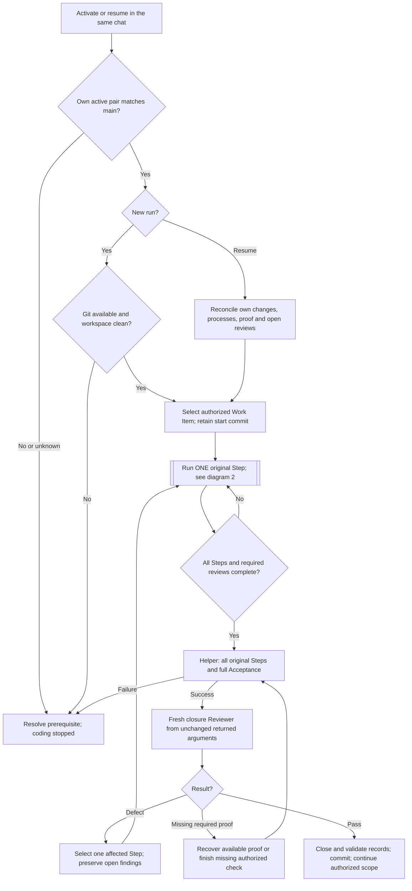
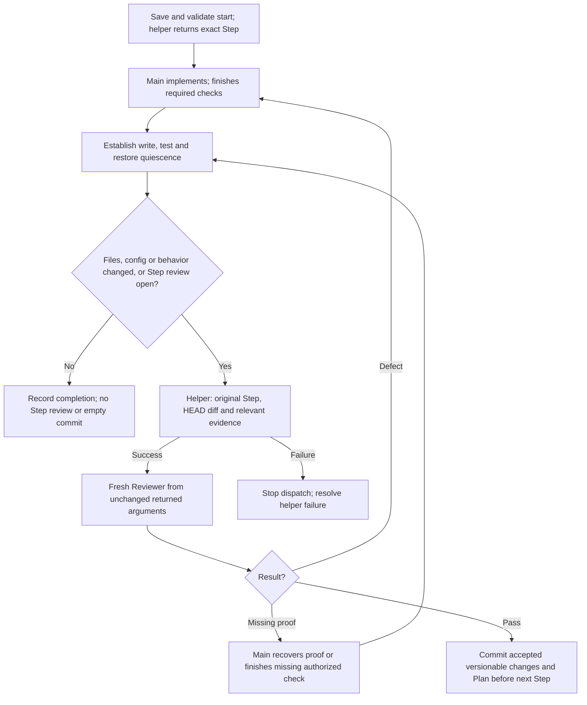
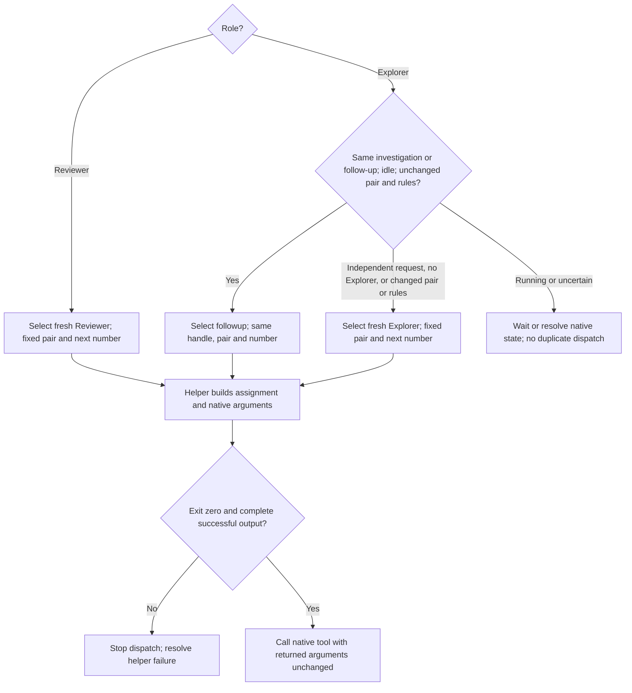
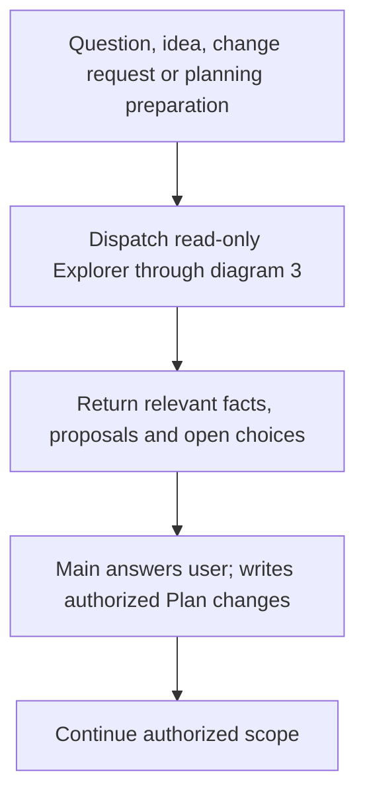

# Scoville Suite for Codex Mainloop

Scoville keeps planning, implementation and checks in your current Codex chat.
Workflow takes the Plan through its original Steps, read-only Explorers
investigate questions and fresh Reviewers check the work. Ask brings in
independent advice, Handoff prepares a continuation and Setup manages project
settings.

Scoville is the scale for chili heat. These Skills aim for sharper work and
less diluted context. Adding more instructions is easy. Keeping the useful
ones is the point.

For Claude Code and other Agent Skills hosts, use
[Scoville Suite](https://github.com/benjaminstelzer/scoville-suite).
For Codex desktop, use
[Scoville Suite for Codex Mainloop](https://github.com/benjaminstelzer/scoville-suite-for-codex-mainloop),
which adds Workflow, Ask and Setup. Mainloop is the maintained Codex suite.

| Skill | Purpose |
| --- | --- |
| [Workflow for Codex](#scoville-workflow-for-codex) | Plans and codes in the current chat, with read-only Explorers and fresh Reviewers. |
| [Code](#scoville-code) | Keeps implementation, risk assessment and checks focused on what you asked for. |
| [Plan](#scoville-plan) | Keeps longer work, decisions and progress easy to pick up again. |
| [UI](#scoville-ui) | Builds and checks interfaces with their framework and design system. |
| [Handoff](#scoville-handoff) | Passes unfinished work to another session. |
| [Ask for Codex](#scoville-ask-for-codex) | Asks the advisers you configured for an independent opinion. |
| [Setup](#scoville-setup) | Manages the selected project's Scoville settings. |
| [Project Context Cleanup](#scoville-project-context-cleanup) | Keeps requested project rules and index text clear without losing required context. |
| [Skillwriter](#scoville-skillwriter) | Writes and reviews Skills and reusable prompts for frontier models. |

## Scoville Workflow for Codex

Mainloop takes a prepared Plan through implementation, independent review and
corrections. Your current chat plans, codes and runs checks. Read-only Explorer
and Reviewer subagents supply investigation and independent review.

Assign a complete Plan or a bounded part. For a tiny fix, coordination may cost
more than the fix. Workflow is available only through the complete Codex
Mainloop suite.

### How it works

The current chat owns the Plan, code, required checks and commits. It takes one
original Step at a time through the existing helper; it does not paraphrase the
assignment. Each review is fresh. Explorer reuse requires the same investigation,
an idle agent and unchanged pair/rules; an independent request starts fresh.
Agents choose relevant Skills without gaining additional role rights.

#### 1. Main loop



The new-run Git gate never cleans or commits earlier work. Authorized resumption
reconciles the same started work without prematurely committing it. Missing or
foreign evidence remains an explicit boundary. Stops preserve unfinished work;
compaction continues this same chat from actual Plan, Git, effects and results.

#### 2. Step implementation and review



Keep source and binding inputs unchanged during review. Closure uses the Work
Item start commit, not only the last Step diff. Unexpected HEAD movement must
be reconciled before an empty diff counts as unchanged. Git does not replace
proof of non-file effects. Preserve necessary nonrepeatable evidence through
existing results or artifacts; no mandatory per-Step report or source archive.

#### 3. Child selection



Fresh children receive role, writing, shell and result rules once. Explorer
reuse sends only its new task and needed context/evidence; new or changed sources
remain readable. No context measurement or thresholds. Close finished Reviewers
only if native close exists. Interruption proves neither termination nor freed
capacity. Native types are optional; never raise thread limits automatically.

#### 4. Questions and planning preparation



Known progress and stop/resume handling need no exploration. A scope-invalidating
change stops dependent implementation first. Explorer writes no Plan or code;
Reviewer runs no project tests. All roles follow the current user's language.

### What it enforces

- **Runtime:** Codex desktop, Python 3.11+, Git and the required native spawn,
  wait, inspection and interruption tools. Explorer reuse needs followup.
- **Start:** A new run requires a clean Git workspace. Authorized continuation
  reconciles its own started work; it never absorbs foreign changes.
- **Ownership:** Main plans, codes, checks and commits. Explorer and Reviewer
  remain read-only. Changed Steps receive independent review; every Work Item
  receives closure over all original Steps and full Acceptance.
- **Boundaries:** Commit accepted versionable Step changes and Plan before
  advancing. No intermediate, empty or foreign-change commit. Keep review quiet.
- **Children:** Every review is fresh, including corrections, evidence followups
  and closure. Explorer reuse retains rules and pair within the same investigation;
  independent requests get fresh Explorers, even in the same project or file.
- **Continuity:** Preserve actual effects, open reviews and stop position through
  compaction in the same chat. No automatic successor or capacity changes.

No minimum Codex version has been independently established. Optional native
type selection and close are not required. Use them only when exposed and
compatible. Agent capacity depends on the host's configured limit.

Workflow activation authorizes accepted-Step commits subject to user and project
restrictions. See [operations](https://github.com/benjaminstelzer/scoville-suite-for-codex-mainloop/blob/main/packages/scoville-workflow-for-codex/scoville-workflow-for-codex/references/operations.md).

### What it costs

Independent review and necessary corrections add tokens and time. Mainloop
removes the implementation child and its coordination. Every review initializes
a fresh agent; Explorer can retain context. Actual quality, time and token effects
need comparable native runs; source size alone proves no saving.

[How to use Scoville Workflow for Codex](members/scoville-workflow-for-codex/README.md#how-to-use).

## Scoville Code

Passing tests are useful. Passing tests for the wrong behavior, rather less so.
Scoville Code keeps implementation, debugging and review tied to the result you
asked for: find the cause, work with the existing architecture and check what
actually changed.

Scoville measures chili heat. Code aims for sharper reasoning before a small
fix acquires its own framework.

### How it works

- Establish the requested result and find the code responsible for it.
- Fix the cause within the project's architecture and your authorized scope.
- Check the affected behavior and relevant performance costs.
- Reassess failed fixes, report remaining limits and stop when further checks
  would no longer change the decision.

### What it enforces

- **Work that serves the request.** Refactors, safeguards and tests need a
  concrete purpose. The agent asks about material choices and settles routine
  details from the project.
- **Your conventions.** Existing architecture and project rules take precedence.
  New projects start with a small structure organized by responsibility.
- **Evidence that fits the change.** Check the behavior, preserve guarantees and
  distinguish observed results from what remains unverified.

Keep personal conventions outside the installed Skill so updates preserve them.
See the [customization guide](https://github.com/benjaminstelzer/scoville-code#your-own-conventions)
and [full instructions](https://github.com/benjaminstelzer/scoville-suite-for-codex-mainloop/blob/main/packages/scoville-code/scoville-code/SKILL.md).

### What it costs

- Reading relevant code and checking behavior takes tokens and time. The extra work is aimed at avoiding fixes that merely look finished.

[How to use Scoville Code](members/scoville-code/README.md#how-to-use).

## Scoville Plan

Scoville Plan keeps goals, decisions and progress in the repository so longer
work survives the next conversation. You can see what is done, what remains
and why a choice was made without reconstructing it from chat history.

Use it for work with dependencies or several sessions. Settle the requirements
and acceptance criteria before implementation, get independent advice where
useful, and revise the Plan when the facts change. A contained fix can stay small.

Scoville measures chili heat. Plan keeps the direction from being diluted by
one more perfectly reasonable detour.

[Plan Viewer](https://github.com/benjaminstelzer/scoville-plan-viewer/releases/latest)
shows these records on Windows, macOS and Linux.

### How it works

- Use the repository's existing planning system and relevant Plan, Work Items and Decisions.
- Check current sources before starting the next item.
- Edit Markdown and YAML records with observed Step progress and any additional Instructions.
- Record concise acceptance results before completion and validate the records.

### What it enforces

- **Resumable work.** Goals, ordered Steps, dependencies and the current position
  stay explicit in the project's records.
- **Decisions with an owner.** Confirmed choices are recorded. Open questions
  remain proposals and block only the work that depends on them.
- **Evidence before completion.** Finished means acceptance was checked.
  Changes of direction preserve completed work, binding constraints and material decisions.

Edit records from one session at a time. Concurrent edits need reconciliation.
See the [full instructions](https://github.com/benjaminstelzer/scoville-suite-for-codex-mainloop/blob/main/packages/scoville-plan/scoville-plan/SKILL.md).

### What it costs

- Maintaining records takes tokens and time. It pays for continuity on dependent work. A small fix rarely needs a large Plan.

[How to use Scoville Plan](members/scoville-plan/README.md#how-to-use).

## Scoville UI

Scoville UI builds and audits interfaces with the project's framework and
design system. It covers clear wording, useful hierarchy, responsive layouts
and accessible interactions, then checks the rendered result. A tidy component
tree is a start. People still have to use the page.

It includes specific guidance for plugin-owned WordPress admin pages, using
Core components and WordPress conventions.

Scoville measures chili heat. UI aims for a sharper interface without making
the user sweat.

### How it works

- Establish the user's task, approved design direction and framework components.
- Build the affected views, wording, states and responsive behavior.
- Inspect the rendered interface and try its relevant interactions.
- Apply the WordPress adapter to supported plugin-owned admin pages. Editor
  surfaces and metaboxes keep their host's conventions.

### What it enforces

- **A coherent interface.** Hierarchy, controls and terminology follow the task
  and the existing design system.
- **Usable states.** Loading, empty, error and success states receive the same
  attention as the convenient example with perfect data.
- **Access across devices.** Check responsive layout, zoom, reading order,
  contrast, focus and keyboard or touch operation where applicable.
- **Rendered proof.** Source checks alone cannot establish that the interface
  works. Unchecked rendering or interaction stays explicitly unverified.

See the [full instructions](https://github.com/benjaminstelzer/scoville-suite-for-codex-mainloop/blob/main/packages/scoville-ui/scoville-ui/SKILL.md).

### What it costs

- Rendered inspection and interaction checks take tokens and time. They catch problems the source alone cannot show. WordPress tasks also load platform guidance.

[How to use Scoville UI](members/scoville-ui/README.md#how-to-use).

## Scoville Handoff

Scoville Handoff turns the current task into one copy-ready continuation
prompt: the goal, decisions, unfinished work, blockers and next action.
Another session can pick up the work without asking you to explain it all again.

Scoville measures chili heat. Handoff keeps the useful context from being
diluted between conversations. The next agent already has enough imagination.

### How it works

- Read the conversation and the task sources already named or established.
- Capture the facts needed to resume, including permissions and unfinished work.
- Produce one prompt in the requested language, otherwise the conversation
  language. The receiving agent checks current state before acting.

### What it enforces

- **Explicit transfer.** A handoff starts when you request one. Preparing it is
  read-only and does not advance the task.
- **Faithful context.** Decisions, permissions, ownership and blockers survive
  the transfer. Unknown results stay unknown, and secrets stay out.
- **A useful next action.** The prompt tells the next session where to resume
  and how to recognize completion.

Keep preferences distinct from binding requirements. The receiving session
still needs the exact permissions and acceptance criteria for its next action.

See the [full instructions](https://github.com/benjaminstelzer/scoville-suite-for-codex-mainloop/blob/main/packages/scoville-handoff/scoville-handoff/SKILL.md).

### What it costs

- Preparing the prompt takes tokens and time once, so the next session has less context to reconstruct.

[How to use Scoville Handoff](members/scoville-handoff/README.md#how-to-use).

## Scoville Ask for Codex

Scoville Ask gets independent advice from the advisers you choose and returns
it to your current task. Use it for a patch review, a second opinion or a
comparison of approaches. Each adviser gets the question and relevant evidence
with fresh context.

Scoville measures chili heat. Ask adds a little heat to your assumptions.
Unanimous agreement is pleasant, but finding the missed problem is more useful.

### How it works

- Select configured advisers using native Codex agents or the Claude CLI.
- Give each the same question, scope and relevant evidence independently.
- Collect separate reviews or combine answers to a general question. Follow-up
  questions continue with the same adviser and context.
- Show missing answers and failed starts alongside completed results.

### What it enforces

- **Independent advice.** Advisers assess the work. Changes remain with the
  calling task. Native read-only behavior is instructed, not sandbox-enforced.
- **Traceable answers.** Results stay attached to their adviser and question.
- **Explicit failures.** Unavailable models, invalid settings and failed calls
  are reported. Ask does not quietly choose a different adviser.

Claude uses read tools by default. Web access requires `claude.web_tools`.

### What it costs

- Each adviser adds model usage, waiting and agent capacity. Use extra opinions for decisions worth checking. You still have to weigh disagreements.

[How to use Scoville Ask for Codex](members/scoville-ask-for-codex/README.md#how-to-use).

## Scoville Setup

Setup shows the Scoville settings your project actually uses and saves the
changes you request. Models, reasoning levels and Workflow settings stay in
one project file, with defaults filling the gaps.

Scoville measures chili heat. Setup lets you choose the seasoning instead of
discovering it halfway through the meal.

### How it works

1. Resolve this project's settings with consumer defaults.
2. Validate only the requested changed section.
3. Save a valid change atomically; preserve unrelated settings.

Cleanup is the sole old-Workflow migration operation. It resolves effective
legacy pairs, asks for ambiguous choices and validates the whole candidate
before one save. It creates no agents or Plan changes.

### What it enforces

- Saves settings only when you ask and leaves unrelated values alone.
- Rejects invalid values before writing.
- Changes configuration between runs. It doesn't start or supervise a
  workflow.

### What it costs

- Viewing or changing settings takes an agent interaction. Saved project settings spare you from repeating the same choices in later runs.

[How to use Scoville Setup](members/scoville-setup/README.md#how-to-use).

## Scoville Project Context Cleanup

Project rules grow. Unfortunately, clarity does not grow automatically with
them. This Skill adds or revises the rules you request in
`AGENTS.md` and
context in `PROJECT_INDEX.md`, keeping useful information where the next agent
will find it.

It preserves meaning, scope and safeguards. Suitable text stays as it is.

Scoville measures chili heat. Context Cleanup removes the dilution, not the
ingredients that made the rules useful.

### How it works

- Resolve the target file and read its relevant governing rules.
- Check the addition for useful project information, duplicates and conflicts.
- Place concise wording in the affected structure, with conditions and exceptions together.
- Inspect the saved change and use the record owner's checks where required.

### What it enforces

- Requested additions and cleanup stay within the named project-context files.
- Scope, conditions, permissions, safeguards and necessary reasons survive edits.
- Existing formats and record owners remain responsible for fields and lifecycle.
- Suitable text stays unchanged, and unresolved material choices are asked directly.

### What it costs

- Reading the rules and checking edits takes tokens and time. The useful return is clearer context for later work, without deleting necessary detail.

[How to use Scoville Project Context Cleanup](members/scoville-project-context-cleanup/README.md#how-to-use).

## Scoville Skillwriter

Scoville Skillwriter writes and reviews Skills and reusable prompts for current
frontier models. It keeps the goal, real constraints and useful context while
cutting repetition and unnecessary ceremony.

Scoville measures chili heat. Skillwriter keeps instructions sharp without
seasoning every sentence with another warning.

### How it works

It combines a shared instruction-design core with an authoring workflow: review before revision, preserve the baseline, and validate the affected outcome. The host's Skill Creator owns Skill structure and packaging.

### What it enforces

An Agent Skills host with filesystem access. Skill authoring also uses the host's Skill Creator; standalone prompts do not need it. No runtime scripts or network access are required.

### What it costs

The Skill has no paid service calls. Host model usage and any explicitly requested evaluation have their usual costs.

[How to use Scoville Skillwriter](members/scoville-skillwriter/README.md#how-to-use).

## Compatibility

Requires Codex desktop, native agents and Python 3.11+, with a signed-in
Claude Code CLI for Claude consultations (2.1.280+ for Opus 5.5).
Targeted candidate-path tests in Codex used gpt-6.1-sol / low, with observed
outcomes and limits described per Skill, and do not establish suite-wide
reliability, installed discovery, other hosts or Claude execution.

## Install the suite

Install the complete suite in your agent host to use it across projects.
Workflow starts in a saved Codex project.

### New installation

Use this request in your agent host:

```text
Install and enable the complete suite for all my projects from the packages/ directory of https://github.com/benjaminstelzer/scoville-suite-for-codex-mainloop.
Preserve personal settings and unrelated Skills. Ask before overwriting conflicting customizations.
Report the installed location and whether the host discovers every member.
```

Do not mix standalone and suite copies of the same Skill. If your host cannot
install from GitHub, download the repository and copy each
`packages/<name>/<name>/` Skill directory into the host's Skills location.
The repository root and development sources are not installable Skills.

### Upgrade or migrate an existing installation

Choose the target suite explicitly. Preserve project settings and personal
customizations, then replace duplicate installed copies with the target suite's
complete packages. Remove only superseded Skills you have selected for removal.
An upgrade is not permission to erase settings or unrelated Skills.

When moving from an earlier Codex suite, first reach a reviewed,
quiet commit boundary, preferably Work Item closure. Retain required acceptance
evidence and commit a changed tracked Plan before reloading. If essential proof
cannot be retained, finish that Work Item before switching.

Install the complete Mainloop suite from this repository, reload it, then ask
Setup to show the existing project settings. If cleanup is required, explicitly
request migration and choose the complete main pair and any ambiguous role
pairs. Cleanup preserves Ask and unrelated settings. Commit a tracked settings
change under the project's checks before authorized continuation. An ignored
configuration needs no commit. Installation alone proves neither configuration
migration, reload nor the active host model.


## Configuration

Use Scoville Setup to view or save model choices and Workflow settings in
`.scoville/config.json`. Missing values use the bundled defaults. See the
[Workflow configuration](members/scoville-workflow-for-codex/README.md#configuration)
and [Ask configuration](members/scoville-ask-for-codex/README.md#configuration)
for their settings.

## Limitations

### Agent capacity

Codex retains native agent threads from earlier assignments, so longer
Workflow runs and Ask consultations can reach the host's agent limit.
To give these runs more room, raise the limit to 256 in
`~/.codex/config.toml` under `[agents]`. Add the section if it is missing:

```toml
[agents]
max_concurrent_threads_per_session = 256
```

This is the suite's recommendation for longer runs. The
[Codex configuration reference](https://learn.chatgpt.com/docs/config-file/config-reference)
describes the setting. If a start or necessary message still fails, the
affected operation stops and reports the problem with its progress preserved
for continuation.


## Developer links

<details>
<summary>Development and builds</summary>

Both suite editions share one maintained source and Plan. Sources live under
`members/`. Edit README fragments in `development/readme/`,
then run `python development/build_suite.py --write-readmes`. The manifest
`suite.json` owns package membership and README composition.

[Development notes](https://github.com/benjaminstelzer/scoville-suite-for-codex-mainloop/blob/main/docs/README.md)
explain the problems behind the suite. The
[build guide](development/shared/build/fragments.md) covers package generation,
runtime checks and Skill publication integrity. Installed Skills need only their own packages.

</details>

Sources, tests and notes live in this suite. Individual packages leave out
this block and the development files.

- **scoville-code**: [Source](https://github.com/benjaminstelzer/scoville-suite-for-codex-mainloop/tree/main/members/scoville-code) | [Tests](https://github.com/benjaminstelzer/scoville-suite-for-codex-mainloop/tree/main/members/scoville-code/development/tests) | [Notes](https://github.com/benjaminstelzer/scoville-suite-for-codex-mainloop/blob/main/members/scoville-code/development/README.md)
- **scoville-plan**: [Source](https://github.com/benjaminstelzer/scoville-suite-for-codex-mainloop/tree/main/members/scoville-plan) | [Tests](https://github.com/benjaminstelzer/scoville-suite-for-codex-mainloop/tree/main/members/scoville-plan/development/tests) | [Notes](https://github.com/benjaminstelzer/scoville-suite-for-codex-mainloop/blob/main/members/scoville-plan/development/README.md)
- **scoville-ui**: [Source](https://github.com/benjaminstelzer/scoville-suite-for-codex-mainloop/tree/main/members/scoville-ui) | [Tests](https://github.com/benjaminstelzer/scoville-suite-for-codex-mainloop/tree/main/development/instruction_tests) | [Notes](https://github.com/benjaminstelzer/scoville-suite-for-codex-mainloop/blob/main/members/scoville-ui/development/README.md)
- **scoville-handoff**: [Source](https://github.com/benjaminstelzer/scoville-suite-for-codex-mainloop/tree/main/members/scoville-handoff) | [Tests](https://github.com/benjaminstelzer/scoville-suite-for-codex-mainloop/tree/main/members/scoville-handoff/development/tests) | [Notes](https://github.com/benjaminstelzer/scoville-suite-for-codex-mainloop/blob/main/members/scoville-handoff/development/README.md)
- **scoville-workflow-for-codex**: [Source](https://github.com/benjaminstelzer/scoville-suite-for-codex-mainloop/tree/main/members/scoville-workflow-for-codex) | [Tests](https://github.com/benjaminstelzer/scoville-suite-for-codex-mainloop/tree/main/members/scoville-workflow-for-codex/development/tests) | [Notes](https://github.com/benjaminstelzer/scoville-suite-for-codex-mainloop/blob/main/members/scoville-workflow-for-codex/development/README.md)
- **scoville-ask-for-codex**: [Source](https://github.com/benjaminstelzer/scoville-suite-for-codex-mainloop/tree/main/members/scoville-ask-for-codex) | [Tests](https://github.com/benjaminstelzer/scoville-suite-for-codex-mainloop/tree/main/members/scoville-ask-for-codex/development/tests) | [Notes](https://github.com/benjaminstelzer/scoville-suite-for-codex-mainloop/blob/main/members/scoville-ask-for-codex/development/README.md)
- **scoville-setup**: [Source](https://github.com/benjaminstelzer/scoville-suite-for-codex-mainloop/tree/main/members/scoville-setup) | [Tests](https://github.com/benjaminstelzer/scoville-suite-for-codex-mainloop/tree/main/members/scoville-setup/development/tests) | [Notes](https://github.com/benjaminstelzer/scoville-suite-for-codex-mainloop/blob/main/members/scoville-setup/development/README.md)
- **scoville-project-context-cleanup**: [Source](https://github.com/benjaminstelzer/scoville-suite-for-codex-mainloop/tree/main/members/scoville-project-context-cleanup) | [Tests](https://github.com/benjaminstelzer/scoville-suite-for-codex-mainloop/tree/main/development/instruction_tests) | [Notes](https://github.com/benjaminstelzer/scoville-suite-for-codex-mainloop/blob/main/members/scoville-project-context-cleanup/development/README.md)
- **scoville-skillwriter**: [Source](https://github.com/benjaminstelzer/scoville-suite-for-codex-mainloop/tree/main/members/scoville-skillwriter) | [Tests](https://github.com/benjaminstelzer/scoville-suite-for-codex-mainloop/tree/main/development/instruction_tests) | [Notes](https://github.com/benjaminstelzer/scoville-suite-for-codex-mainloop/blob/main/members/scoville-skillwriter/development/README.md)

## License

The bundled Skills use the MIT license. Each package includes its `LICENSE` file.

