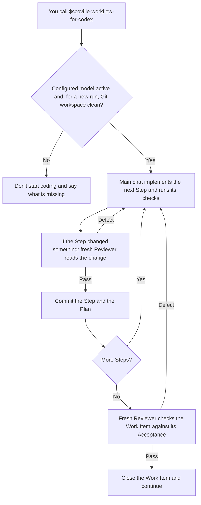

## How it works

- The chat you're in does the work. It plans, codes, runs the checks and
  commits, one Step at a time, exactly as the Plan states it.
- Every Step that changed something gets a fresh, read-only Reviewer. When all
  Steps are done, another fresh Reviewer checks the whole Work Item against
  its Acceptance, unless the Work Item has a single Step, whose review then
  covers the Acceptance.
- Questions, ideas and change requests that need investigation go to a
  read-only Explorer. The main chat answers you and updates the Plan. Neither Explorer
  nor Reviewer writes code or Plan records or runs tests.
- Calling Workflow allows it to commit accepted Steps and their Plan records,
  unless you or the project rules say otherwise. A new run needs a clean Git
  workspace. Workflow won't clean up or commit earlier work to get one.
- When Codex compacts the chat, Workflow carries on in the same chat from the
  Plan, Git and the actual results.
