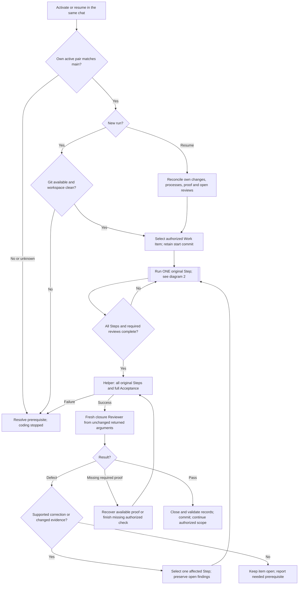
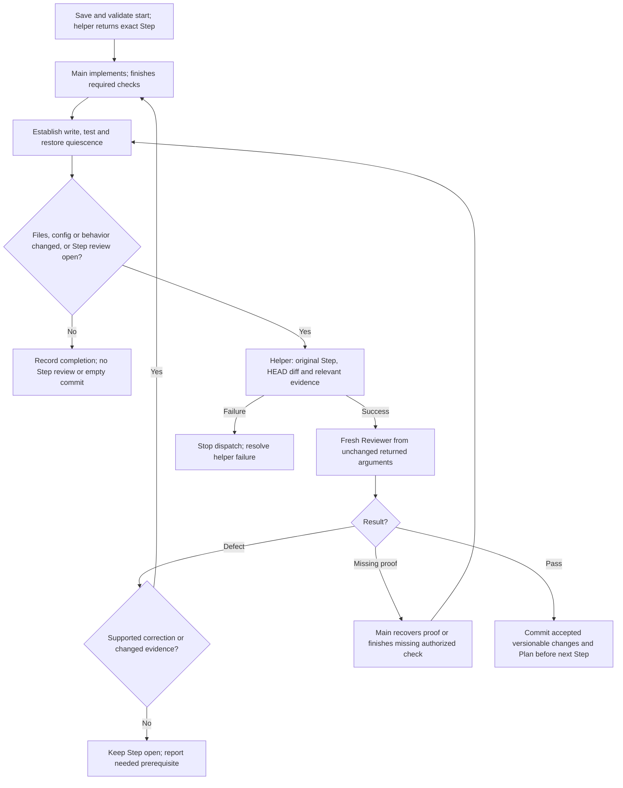
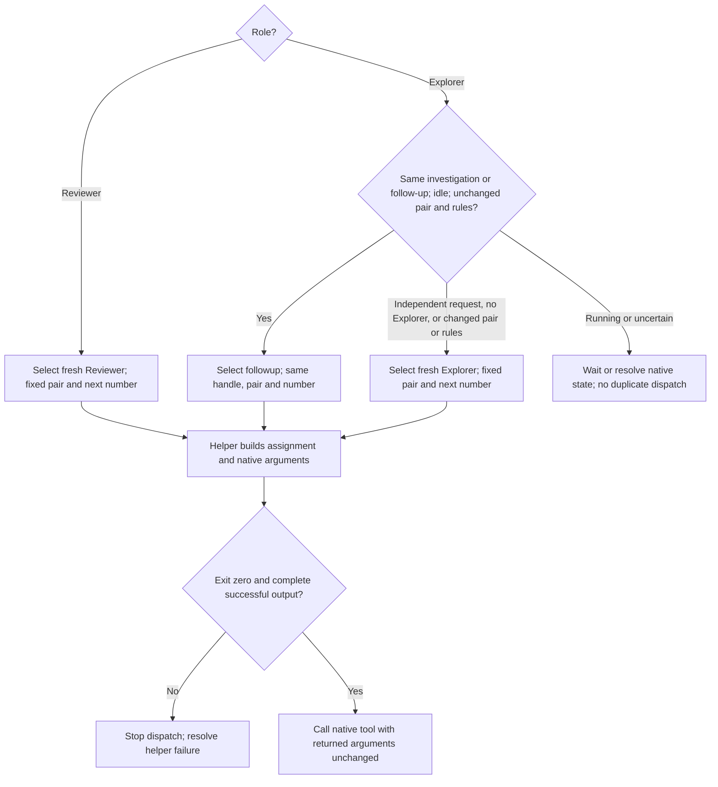
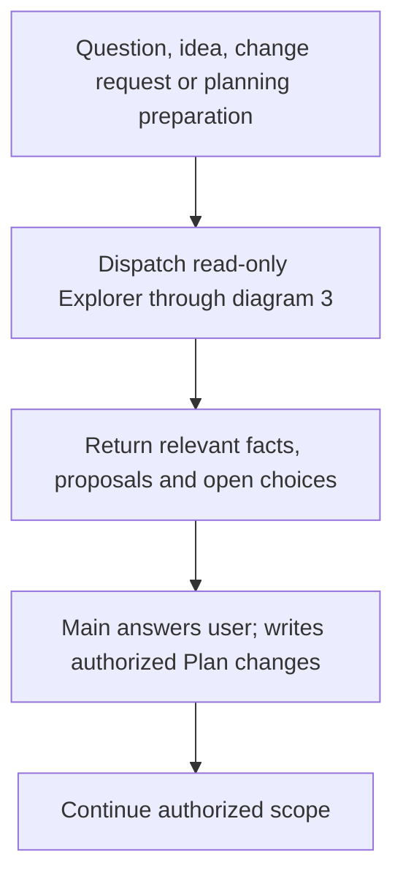

## How it works

The current chat owns the Plan, code, required checks and commits. It takes one
original Step at a time through the existing helper; it does not paraphrase the
assignment. Each review is fresh. Explorer reuse requires the same investigation,
an idle agent and unchanged pair/rules; an independent request starts fresh.
Agents choose relevant Skills without gaining additional role rights.

### 1. Main loop

The new-run Git gate never cleans or commits earlier work. Authorized resumption
reconciles the same started work without prematurely committing it. Missing or
foreign evidence remains an explicit boundary. Stops preserve unfinished work;
compaction continues this same chat from actual Plan, Git, effects and results.

### 2. Step implementation and review

Keep source and binding inputs unchanged during review. Closure uses the Work
Item start commit, not only the last Step diff. Unexpected HEAD movement must
be reconciled before an empty diff counts as unchanged. Git does not replace
proof of non-file effects. Preserve necessary nonrepeatable evidence through
existing results or artifacts; no mandatory per-Step report or source archive.

### 3. Child selection

Fresh children receive role, writing, shell and result rules once. Explorer
reuse sends its new task and needed context/evidence. Embedded writing and shell
rules satisfy their required reads; unchanged rules stay loaded. Machine-data,
Python discovery and large-output rules load when the operation needs them.
Fresh assignments include accepted Decision text or its valid binding-section
projection; reuse carries current source identities and reads new, changed or
uncertain Decisions. No context measurement or thresholds. Close finished Reviewers
only if native close exists. Interruption proves neither termination nor freed
capacity. Native types are optional; never raise thread limits automatically.

### 4. Questions and planning preparation

Known progress and stop/resume handling need no exploration. A scope-invalidating
change stops dependent implementation first. Explorer writes no Plan or code;
Reviewer runs no project tests. All roles follow the current user's language.
