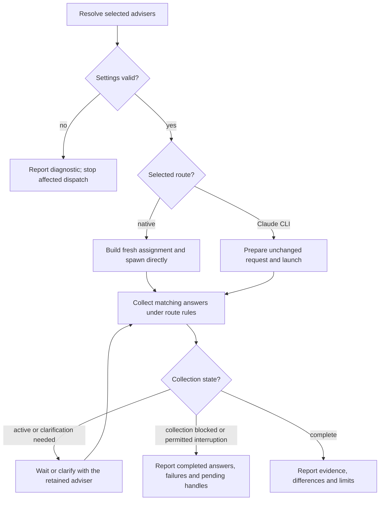

# Scoville Ask for Codex

Collect independent answers in the calling task. A review asks each adviser to
assess the same evidence; a general consultation combines independent answers
into a synthesis. The caller owns subsequent changes; advisers inspect without
changing the subject, running tests or delegating.

Before requesting or reading machine reports, logs or structured state, or writing adviser
framing or results, read and apply the
[shared writing rules](references/writing.md). The helpers include those rules
for adviser answers while preserving the literal user question.
For composed adviser questions and follow-ups, apply
[agent instruction design](references/instruction-design.md).

## Choose the consultation

Infer `review` or `consultation` from the actual question; an explicit mode wins.
“Could this patch lose data?” is a review even without “for review”. If the
intended outcome is ambiguous, clarify before dispatch. Do not ask again when
the request already establishes the mode, advisers or permission.

Resolve settings with `scripts/ask.py`:

| Priority | Settings source |
| --- | --- |
| 1 | Unsaved request overrides. |
| 2 | Selected project's `.scoville/config.json`, `ask` section. |
| 3 | [config.default.json](config.default.json). |

| Adviser selection | Presets |
| --- | --- |
| Explicitly named | Exactly those presets, even if absent from the default list. |
| None named | Default adviser list; it is not an allowlist. |

Select exactly the requested routes, models and efforts. Adviser IDs identify
results; display names are not agent handles. Resolve selected presets in one
call and report each adviser's settings. Read
[configuration and helper inputs](references/configuration.md) for resolution,
migration or the first helper invocation.

Native spawn_agent validates the requested model and effort on the actual host.
Report a host rejection without substituting another model or route.

An explicit Ask request commissions the full consultation: create the needed
adviser subagents, exchange necessary questions and answers, and return results.
Do not ask for separate agent or message approval or require authorization fields.
Respect explicit user limits and host requirements. Native Ask uses direct
collaboration tools in the calling chat.

## Ask and collect

Style generated framing only; preserve literal user questions, quotations,
technical data and hidden expectation keys unchanged, subject to authorized
edits and required secret redaction.

Prepare a self-contained question, scope, requirements and raw evidence. Include
paths and working-tree scope when relevant. Exclude the caller's verdict,
intermediate reasoning, previous adviser answers, unrelated history and secrets
from fresh consultations. Read [native operation](references/native.md) or
[Claude operation](references/claude.md) for each selected route.

Dispatch selected advisers independently with fresh context and resolved
settings, within host capacity and process limits. Each route governs handle
retention, collection and necessary follow-ups. Keep partial answers and
failures visible; never silently replace advisers.

For a consultation, synthesize agreement, differences and useful conclusions
without inventing consensus. No mandatory second exchange round. For reviews,
distinguish findings from untested concerns and verify findings before authorized fixes.

Apply [Evidence-based conclusions](references/writing.md#evidence-based-conclusions)
to exchanges. Present claims and evidence neutrally, including candidate
acceptance or objection questions, without pressuring advisers to agree.
An unexplained concession does not resolve a finding; consensus does not
replace required review acceptance.

Retain requested and actually reported model/effort separately; unavailable
telemetry is unknown.

## Follow-up after completion

Retain the answer, evidence, exact native handle or Claude session ID and
settings. Resume only for an explicitly requested follow-up. Native follow-ups
keep the same settings. A requested change needs a fresh adviser: explain that
choice and obtain it unless already authorized. Claude follow-ups retain settings unless explicitly overridden.
Do not ask whether a completed review should stay open or close it when the user
changes topic.
Claude print-mode exits after its answer; a retained ID is saved history,
not a running agent. Follow the original route and never select the most recent
session implicitly.

{{ include: family.contract }}

Only necessary oversized-answer delivery permits native advisers to create
temporary files, under [native delivery](references/native-delivery.md).
Native spawning adds no technical write barrier or separate sandbox. The
Claude route owns its tool restrictions and opt-in web access.
