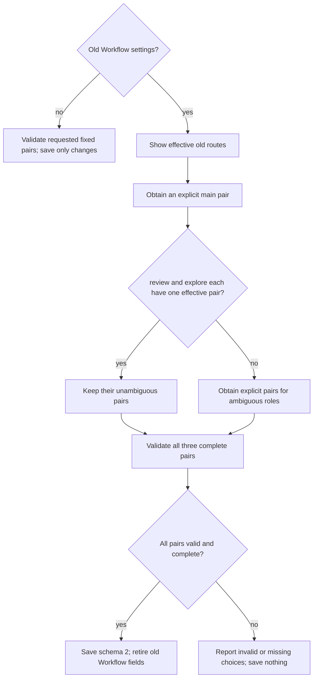

# Scoville Setup

{{ include: family.contract }}

Manage `.scoville/config.json` in the known absolute project root. Overrides
apply per field. There is no personal layer or parent-directory search.
Read the [shared writing rules](references/writing.md) before evaluating settings
or explaining results. Reuse retained matching rules.

{{ include: rules.python }}

## Operations

```text
python "<setup-skill-directory>/scripts/setup.py" show --project-root "<project-root>"
python "<setup-skill-directory>/scripts/setup.py" set --project-root "<project-root>"
python "<setup-skill-directory>/scripts/setup.py" cleanup --project-root "<project-root>"
```

| Operation | Contract |
| --- | --- |
| show | Read only. Show effective fixed pairs or resolve old routes with cleanup_required. Create no file. |
| set | Save only explicitly requested fields. An old Workflow form requires cleanup before a Workflow save; Ask-only saves leave it unchanged. |
| cleanup | Migrate old Workflow settings to schema 2 only when explicitly authorized. Ask and foreign values remain unchanged. An unchanged valid configuration returns saved: false. |
| One-time Ask override | Load Scoville Ask for Codex and read its `references/configuration.md` for read-only settings resolution. Report resolved values without saving or starting advisers. |

Generate stdin JSON with a serializer such as Python `json.dumps` or PowerShell
`ConvertTo-Json -Depth 10 -Compress`. Use the UTF-8 stdin procedure in the
loaded [shell command rules](references/shell-commands.md).
Use `ask`, `workflow` or both for set; use only `workflow` for cleanup.
Include only requested changes. Set offers low, medium, high and xhigh; keep
existing special levels on unrelated saves and migration. Do not hand-write JSON
or silently substitute values. The helper validates changed sections before saving. An invalid choice
does not authorize a partial save.

Check the returned file, saved flag and requested effective values before
reporting success. Report a mismatch or error with its concrete diagnostic;
do not automatically repeat or broaden the save. `saved: false` says this operation wrote nothing; it
does not mean overrides are absent. Set returns only changed effective sections.

## Workflow pairs and migration

Schema 2 has fixed `main`, `review` and `explore` pairs, each with `model` and
`reasoning`. For set, patch only requested fields, such as
`workflow.review.reasoning`. Cleanup choices supply complete pairs.
Defaults come from [Workflow](assets/workflow.toml); do not copy their values
into these instructions. The host controls the actual main-thread model.
Saving its required pair does not change or verify the host model.



Never derive main from execute. Explorer candidates use fieldwise inheritance
from the effective old execute routes. Different pairs have no automatic
winner. Preserve supported special reasoning levels; actual model support still
determines execution. Cleanup starts no agents or tests, edits no Plan and
changes no `.codex` settings. Migrate between runs or at the authorized safe
boundary specified by Workflow.

## Ask

Ask [defaults](assets/ask.default.json) own adviser values. Saved sections are
`advisers`, `presets` and `claude`. Adviser selection replaces the previous list.
Claude fields are `max_budget_usd`, `session_persistence`, `customizations`,
`timeout_seconds` and `web_tools`. A finite budget of zero removes the helper
cap, not charges, provider limits or timeouts. Preserve existing `ask.pin_threads`
on unrelated saves; it has no effect on native advisers.

Keep a one-time choice in the request or Plan Step unless the user explicitly
asks to save it. Change saved settings between runs. Setup never starts advisers
or Workflow, installs or updates Skills, publishes packages, creates a monitor
or adds another configuration system.

{{ include: helper.policy }}
