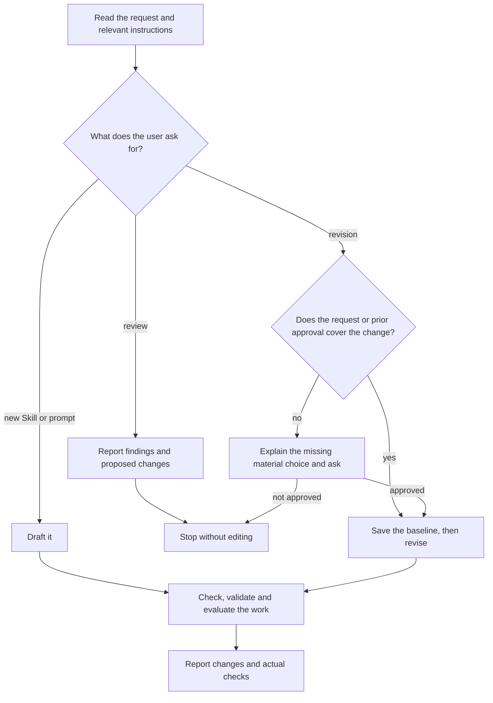

# Skillwriter

Write, simplify or review instructions while preserving their intended
behavior. Read [Agent instruction design](references/instruction-design.md)
once per session and again after it changes; apply its rules.

## Choose the mode

A concrete revision request authorizes its changes. A review edits nothing.
Ask only when a material change to outcome, scope or boundaries is not covered
by the request or prior approval: dropping an approval stop is material,
tightening a sentence without changing what it requires is not. Before revising, preserve the exact affected
pre-edit state through a Git revision containing it or a temporary workspace
copy. Keep this baseline through the final comparison.

## Preserve the intention

Keep the intended outcome, scope, activation boundaries, facts, permissions,
required behavior and acceptance criteria unless the user explicitly asks to
change them. Shorter text alone is not an improvement.

Read the files needed to understand the change and its effects: `SKILL.md`,
references, included fragments and imported prompts. Do not reread
text that is still completely in context and has not changed. Edit the source and regenerate derived copies through their
build path. Before changing shared text, check every file that uses it.

## Work with Skill Creator

For Skill authoring, load the host's `skill-creator`: OpenAI's in Codex,
Anthropic's in Claude Code. It decides structure, metadata, packaging and
format validation; do not edit its files. Skillwriter decides wording. If none
is available, draft the wording and report packaging as unverified. Standalone
prompts need no Skill package.

## Check the work

Review changed instructions and the files that use them once in the existing
source review; for new writing review what you wrote. Check that:

- an agent can complete the task, and required behavior and boundaries are clear;
- authorization, activation and handoffs agree with the files that define them;
- rules remain consistent, without unnecessary duplication or constraints;
- every diagram path agrees with the text. Parse Mermaid with a renderer or
  parser when available; otherwise report the syntax as unverified;
- for a revision, the diff against the baseline holds every approved change
  and no other change to meaning, behavior or boundaries.

Correct deviations within the authorized scope and recheck affected findings.
Report unresolved mismatches. This one source review is the whole authoring
review; write no separate certificate. It shows consistency, not model
performance.

## Validate and evaluate

For a Skill package, validate Skill structure through Skill Creator; this proves
format, not quality.
If a validator rejects a field the Agent Skills specification allows, such as
`compatibility`, keep the field and report the limit.

Choose checks by what the change can affect, using the required target models
and settings. Add model-specific detail only where their results require it.

| Change | Check |
| --- | --- |
| Wording or layout only | Clarity, consistency and preserved meaning against the baseline |
| Required behavior or output | Exercise the affected outcome and preserved boundaries |
| Activation or scope | Explicit and implicit activation, plus adjacent requests that must not activate |

Run a comparative evaluation only when the user requests one or the work
claims improved effectiveness, following
[sources and evaluation](references/sources-and-evaluation.md). Read it also
before citing vendor advice or research; it holds model-specific findings for
pruning prohibitions and stop rules and for low reasoning effort.

Report activation, procedural compliance, boundaries and task success
separately for what was tested. Name what remains unverified. Shorter text, higher
effort or self-reported success do not prove improvement. A claim that a model follows
the instructions requires a run with that model.
