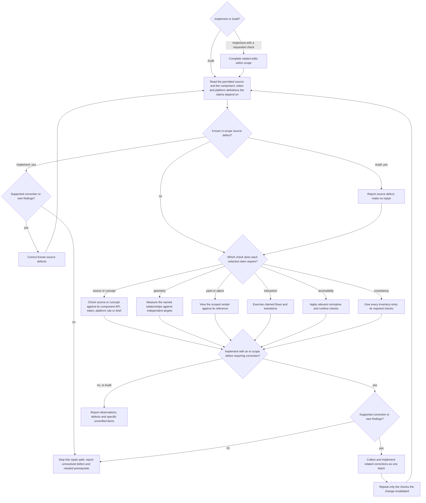

# Rendered UI Validation

Use this file when SKILL.md's References table selects it; its Styling
exceptions section also applies whenever custom styling is written.
Implementing a change alone selects nothing else here; that report names what
was not rendered as unverified.

## Establish the claim

State each claim: what the change is supposed to improve and the observation
that would show it, such as `Save is as high as the fields beside it: equal
rendered heights`. Use the check in its row and read each named reference
completely:

| Claim | Check that settles it | That check does not show | Reference |
| --- | --- | --- | --- |
| Source or build correctness | Read the source; run the relevant existing lint, build or component checks | Rendering, geometry or interaction | — |
| Unimplemented concept | Compare it with the supplied brief and product decisions and reason from this task | Implemented or rendered behavior | [Quality](ui-quality.md) for open concerns |
| Framework or token alignment | Name the component, variant and token that should apply; read the resolved style at the affected element | Painted or layout effect | [Framework](framework-alignment.md) when ownership is open |
| Layout, spacing, alignment or adaptation | Measure the named relationship (edges, centres, sizes) at the actual rendered elements against a target that does not come from the code or render under test | Glyph position, baseline or optical balance | [Geometry and sight](ui-geometry-validation.md) |
| Painted appearance or optical alignment | View the render beside its reference | Exact distances or interaction | Geometry and sight |
| A setting's visible effect or absence | Measure or view the element that consumes the setting | Source agreement, a declaration or a computed value alone | Geometry and sight |
| Interaction or state behavior | Operate the flow and its transitions in an interactive runtime | Visual quality | [Interactions](ui-interactions.md) |
| Accessibility conformance | Run the applicable checks below | Task understanding | — |
| Consistency across a page or region | Check every entry in the scope | A partial sample | [Audit coverage](ui-consistency-audit.md) |

A check settles only its own row: equal heights do not show that the button
works. Use a supplied decision's target and keep the status of its proof.

## Derive the test surface

Before measuring, select the layout claims, normative limits and concrete
risks that can change the result. Use the project's supported environments
and only relevant combinations of:

- viewport, window mode, orientation, or safe-area constraints;
- mouse, keyboard, touch, switch, or platform navigation;
- default, focus, hover, pressed, selected, disabled, loading, success, error,
  empty, or permission states;
- supported themes and contrast modes;
- realistic short, long, dynamic, and localized content; and
- text scaling, browser zoom, reduced motion, and other supported user settings.

Include a condition when it could change the decision or expose a failure in
the requested flow. Take the transition points from the breakpoints the
project, design system or platform defines and the applicable normative
limits, for example 767px and 768px for a toolbar that stacks below 768px. A
broad viewport may establish composition without being an accessibility
threshold.

For affected web UI with an AA target, include these applicable checks:

- Operate the affected primary flow using only the keyboard and inspect visible
  focus at each step. Retain [WCAG 2.1.1's exceptions](https://www.w3.org/WAI/WCAG22/Understanding/keyboard.html)
  and verify [WCAG 2.4.7](https://www.w3.org/WAI/WCAG22/Understanding/focus-visible.html).
- For each affected view, check reflow at an equivalent width of 320 CSS px for
  vertically scrolling content, such as 1280px at 400% zoom. Preserve information
  and functionality; the exception for content requiring two-dimensional layout does not exempt
  the whole page. See [WCAG 1.4.10](https://www.w3.org/WAI/WCAG22/Understanding/reflow.html).
- Calculate contrast for distinct new, changed or audited text and background pairs
  in their rendered states: 4.5:1, or 3:1 for large text (at least 18pt/24 CSS px,
  or 14pt/18⅔ CSS px bold), retaining
  [WCAG 1.4.3's exceptions](https://www.w3.org/WAI/WCAG22/Understanding/contrast-minimum.html).
- Required non-text control and state cues and authored focus indicators need 3:1
  against adjacent colors. Apply [WCAG 1.4.11's scope and exceptions](https://www.w3.org/WAI/WCAG22/Understanding/non-text-contrast.html),
  including inactive controls and unmodified browser-owned appearance; do not
  apply the threshold to every decorative surface.

Further conditions by case:

- Elements were added, removed or changed: include the affected group's
  composition and responsive transitions, not only the edited element. Check
  the widths and states that could expose broken grouping, wrapping, overflow
  or unavailable actions.
- A flow supports several input methods, and one can leave focus, selection,
  pointer capture, composition or shared state that affects another: exercise
  at least one such handoff in the same task, such as pointer to keyboard.
  Separate clean-start passes per method do not prove the transition. Build no
  cross-input matrix for methods that behave independently.
- A shared component changed: inspect each immediately affected use that
  differs in role, variant, state or layout relationship. Render
  representative distinct uses; identical copies need no separate proof.
- Polished presentation is an explicit outcome: render a representative
  populated state, not only an empty, loading or error state, with realistic
  information density, content lengths, hierarchy and at least one relevant
  interaction state. Capture each target viewport the task names as its own
  observation; a desktop result does not stand in for mobile or the reverse.

Keep populated and recovery-state evidence distinct.

Compare the rendered emphasis with the primary task. Decision-critical values,
states and actions stay readily readable and findable, and no decoration
obscures or competes with them. Judge the task, not a fixed size hierarchy or
a prescribed visual style.

## Styling exceptions

Before custom styling, including inline styles and styling props:

1. Name the unmet requirement and the exact API or component responsible.
2. Say why its supported behavior is insufficient; prefer supported
   composition and variants. Using an official token does not alone justify
   the exception.
3. Name the smallest affected scope and keep the exception to it.
4. Keep this rationale in the task result or an existing project record; no
   separate document is required. Example: `Button sm is 32 high, the 24-high
   tag row needs 20, no smaller variant: local height on .tag-remove only`.

Inspect the final diff for unnecessary custom styling and for compensation
whose cause is gone.

## Select and refresh evidence

- Run the branches the claims need, not every branch for every task.
- Source findings come before conclusions from the render, and known
  corrections before the final measurement or viewing. In the relevant
  markup, component APIs, styles and the component and token definitions
  behind them, look for duplicate spacing, a literal that bypasses a token,
  arbitrary offsets, a rebuilt primitive and compensation whose cause is
  gone. A passing lint, build or component check shows neither that the right
  component, variant and token are used nor that the render is correct.
- The flow adds no scope or permission. Source-only and screenshot-only
  requests keep their limits.
- If a required source or runtime tool is unavailable, continue with the
  permitted observations and the tools you have. Report each missing check as
  unverified, not passed.
- Final measurements and viewed images represent the same revision, content
  and state.
- Reuse a result while the inputs and conditions it depends on are unchanged.
- After repeated failed corrections, continue with a supported diagnosis
  instead of another unchanged attempt. Keep acceptance open and name the
  actual prerequisite.

## Use automation as supporting evidence

Run the project's existing component, integration, visual-regression and
accessibility checks that cover the change. Add or change automated coverage
only when it protects a behavior that can regress and the repository has a
canonical test seam. Screenshot churn and assertion-free tests prove nothing;
do not add them to simulate proof.

Treat scanner output as a lead and a bounded check. Confirm relevant findings
in the rendered interface and interaction path.

## Report the result

Report:

- the surfaces and conditions actually rendered;
- the task and states exercised;
- relevant automated checks and their result;
- framework or design-system alignment observed; and
- residual unverified conditions or owner conflicts.

For Audit, prioritize findings by affected task, owner and consequence.

When supplied proof explicitly names conditions it did not observe and they
limit the requested claim, keep each of them or an equally precise grouping:
`not checked: 320px, dark theme, error state`, not
`some conditions unchecked`.

When a check covers only some conditions, state them: `no overflow at 320px
and 768px`, not "responsive", "accessible" or "looks good".

## Interface text evidence

For new or changed interface text and for consistency audits, compare concept
names across affected views, states and in-scope languages using
[Wording](ui-wording.md). Check that labels describe actual behavior. Inspect
wording in source and in rendered context; source alone proves neither its
presentation nor the action's runtime behavior.
