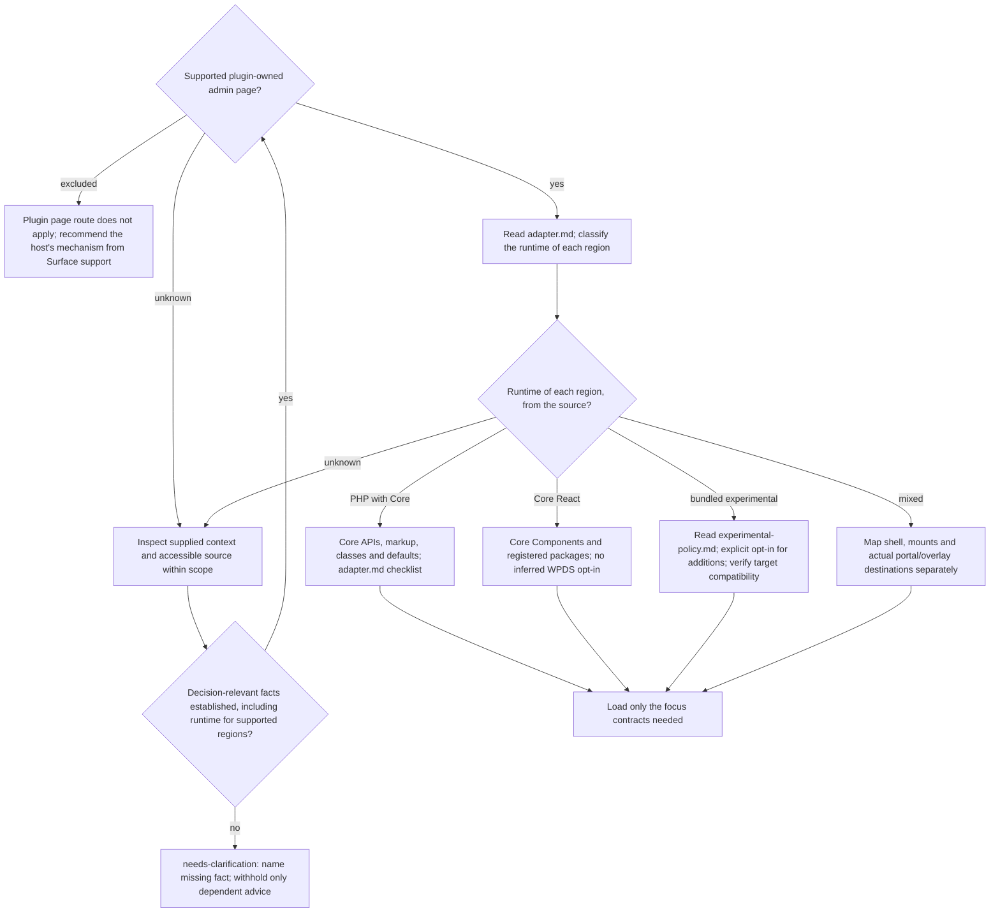

# Task, surface, and runtime routing

Read this file for every wp-admin recommendation, including hypothetical
advice. It settles three things in this order: which concerns the task covers,
whether the surface is a supported plugin page, and which runtime renders each
region. The mode (Implement or Audit) comes from Scoville UI.
Read [classification-output.md](classification-output.md) only when the user
explicitly asks for a structured classification report; ordinary advice does
not need it.

## Select the focus

Take the page or region and the concerns from the request. Add a concern only
when the request names it or the requested work cannot be done correctly
without it.

- A page audit covers the concerns that apply to that page, not every plugin
  screen.
- A targeted audit covers the named concern and what it depends on.
- Implement applies the rules to the new page or the changed region, not to
  unrelated screens.

| Focus | Inspect | Main reference |
| --- | --- | --- |
| Spacing, vertical flow and composition | Before choosing gaps, margins, padding, stacks, cards, fields or portals: which element sets each distance (parent gap, child margin, Core default) and which children are hidden. A requested rendered check, or a requested review of how the page looks, also measures the rendered distances. | [spacing.md](spacing.md) |
| Core defaults, tokens, and CSS | Which runtime renders the region, which Core markup and components it reuses, whether each token it consumes is registered and enqueued for the page, and, before custom styling, the styling-exception rationale. | [spacing.md](spacing.md); [version-compatibility.md](version-compatibility.md) for token/provider availability, loading, fallback or version-sensitive advice |
| Responsive layout | Page shells, columns, toolbars, data views, narrow widths, zoom, RTL and content expansion: affected reflow, wrapping, overflow, order and relevant widths. | [responsive.md](responsive.md) |
| User guidance and states | Navigation, hierarchy, actions, forms, Notices, and the loading, empty, success, error, disabled, permission and recovery states that can occur in the selected flow. | [ui-guidance.md](ui-guidance.md) |
| Accessibility | Relevant semantics, keyboard and focus behavior, labels, contrast, targets, and reflow. | [ui-guidance.md](ui-guidance.md), [responsive.md](responsive.md) for layout |
| Interface text, locale values, translation loading or i18n-readiness | New or changed visible and accessible strings, dates, numbers, domains, formatting, dependencies, loading hooks, localized layout, expansion and language-scoped RTL. Translation delivery only when requested. | [internationalization.md](internationalization.md) |

A reference serves the selected focus and does not widen it. Example: a
spacing review stays a spacing review; it adds no translation catalogs, RTL
check, navigation redesign or inventory of every state.

When Scoville UI selects [common Validation](../validation.md) for the task,
apply the [WordPress additions](validation.md) in the same check. A check of
page consistency also reads
[Audit coverage](../ui-consistency-audit.md).

## Surface support

Find the surface in one of the two tables. When the request and the
accessible source do not show where the UI is placed, treat the page shell as
unknown and follow the `unknown` branch of the diagram below. That a UI uses
React or opted in to experimental components does not show that it sits in a
Core page shell.

Supported: continue with [adapter.md](adapter.md).

| Surface | Page shell | Rule |
| --- | --- | --- |
| Plugin single-site settings or tool page | Core shell | Keep working Classic elements and defaults. |
| Plugin workflow, dashboard or data view | Core shell; a plugin root only where a script renders the region | Give each region one runtime and one source of spacing. |
| Plugin Network Admin page | Network Admin shell | Supported only when the request or source shows the Multisite context. Establish where the page is placed separately from which runtime renders it. |

Excluded: the surface belongs to a host, so the plugin page route does not
apply. Use or recommend the host's own mechanism instead.

| Surface | Host | Recommend | Do not recommend |
| --- | --- | --- | --- |
| Block Editor sidebar or document panel (SlotFill) | Block Editor | `PluginSidebar` for an own sidebar or `PluginDocumentSettingPanel` for a panel in the document settings, both from `@wordpress/editor` and registered with `registerPlugin()`. Inside: `PanelBody`, `PanelRow` and controls from `@wordpress/components`. These components bring their own spacing. | `form-table` paddings or pixel values copied from the settings page; global editor CSS; frontend-theme spacing. |
| Editor canvas | Editor | The block that renders there: its own styles and its `spacing` block support (`margin`, `padding`, `blockGap`). | Admin-page spacing or frontend-theme spacing values prescribed from outside the block. |
| Post metabox | Core post screen | `add_meta_box()` on the `add_meta_boxes` action. The callback prints only the box content with Core form markup; Core renders the box frame, title and spacing. | Experimental WPDS components injected into the box; global admin overrides. |
| Dashboard widget | Core Dashboard | `wp_add_dashboard_widget()` on the `wp_dashboard_setup` action. The callback prints only the widget content; Core renders the widget frame. | Experimental WPDS injection; global admin overrides. |
| Profile field | Core profile screen | Print the fields on `show_user_profile` and `edit_user_profile` as rows of a `<table class="form-table">` like that screen's own sections; save on `personal_options_update` and `edit_user_profile_update`. | Experimental injection; global overrides; custom CSS before checking what Core's markup already gives. |
| Existing Core list or screen, including the list and edit screens Core generates for a plugin's post type or taxonomy | That Core screen | The hooks and filters the screen provides, such as `manage_{$screen->id}_columns` for list-table columns. Core renders the markup and spacing. | Experimental WPDS injection; global admin overrides. |
| UI inside another plugin | Host plugin | The host plugin's documented extension points and its own components. | WPDS advice derived from the fact that the host uses React; advice that depends on host facts neither the user nor the accessible source gives. |

For every excluded surface:

1. Do not apply the plugin page rules: no `.wrap` page shell, no spacing
   scale from [fallback-composition.md](fallback-composition.md), no global
   admin or editor CSS.
2. Use or recommend the mechanism from the table. The host's spacing applies;
   values of the plugin's own settings page are not copied there.
3. Base the advice on the facts the user gave and the accessible source
   shows. Where a missing fact would change the advice, name that fact and
   still answer the rest.

## Choose the runtime per region

Add experimental WPDS components only when the project explicitly opted in to
them; then read [experimental-policy.md](experimental-policy.md) before any
experimental change or advice. Otherwise add no experimental API.

- Leave an existing experimental subtree as it is unless a functional
  requirement needs it changed.
- Core tokens and the public provider are separate capabilities. Using them
  is not an opt-in to experimental components.
- A React region alone shows neither WPDS use nor a Core page shell.
- For token or provider availability, loading, fallback or version-sensitive
  advice, read [version-compatibility.md](version-compatibility.md). A native
  region that consumes no tokens needs no token audit. A PHP page that uses
  Core tokens stays `php-core`.

When a fact is still missing after you inspected the supplied context and the
accessible source, continue every check that does not depend on it and ask
only for that fact. Ordinary findings need no complete classification report;
the structured values and their precedence are in classification-output.md.

## Fact labels

- **Core:** documented API, established admin convention, or explicitly named
  observed implementation with its WordPress version named.
- **WPDS:** documented or observed token or component behavior with its provider
  and version named. This label does not by itself mean experimental.
- **WCAG:** normative accessibility requirement.
- **Skill-Norm:** an openly identified rule that closes an unspecified gap.

Observed Core selectors are not automatically public extension APIs.
