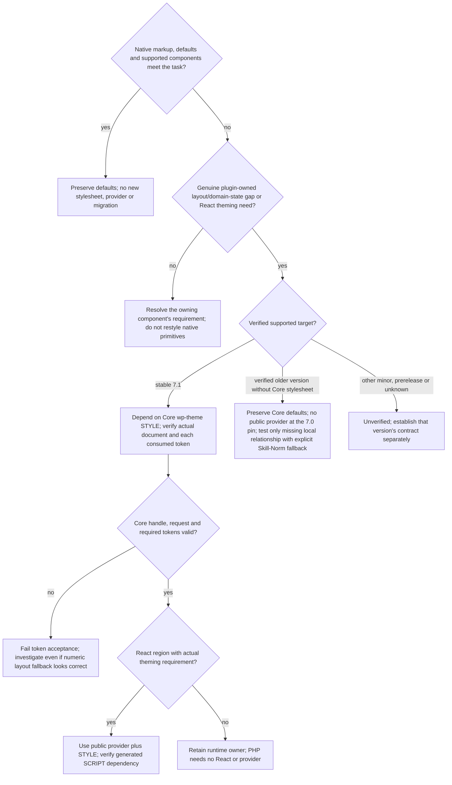

# Versioned Core tokens and public theming

Read this file after routing. The WordPress version, the availability of CSS
tokens and the components of a React region are three separate facts;
establish each. Do not migrate an existing Classic page merely because a
newer WordPress version offers tokens.

Before you use an example, show from the native markup and the component's
options that the relationship is missing. Keep source units and token
expressions. A resolved pixel value from a check describes one named state;
do not write it back as a source declaration. Native relationships are in
[classic-patterns.md](classic-patterns.md), token facts in
[wpds-tokens.md](wpds-tokens.md).

## WordPress version and capabilities

| Target | Core token stylesheet | Public provider | Routing consequence |
| --- | --- | --- | --- |
| 7.0 pinned baseline | No Core `wp-theme` style handle in the verified baseline | Not exported by pinned `@wordpress/theme` 0.7.1 | Preserve Classic pages and Core defaults. The explicitly opted-in bundled experimental path below remains version-specific. |
| 7.1 | Core registers `wp-theme` with semantic tokens for plugin UIs | Public `ThemeProvider` from `@wordpress/theme` through the Core script handle | PHP may consume Core tokens without React. React may use the public provider when needed. Neither requires experimental-component opt-in. |

- Check the actual supported installation and minimum supported version.
- The style and script registries are separate, although both use `wp-theme`.
- A registered handle does not prove enqueue, successful loading, token
  availability or rendering.
- A spacing check on native Core markup that consumes no tokens needs no
  token-loading audit.
- Do not infer future 7.x behavior or package versions from either row.

## Compatibility rules



- Never bundle a second copy of the Core tokens, replace or deregister the
  Core handle, or depend on an unregistered handle.
- Never unlock private APIs, on any version. Pinned 7.0 has no public provider.
- An approved backport to an older version needs its own tested branch that
  checks where the stylesheet comes from and which tokens it has; a present
  handle is not enough.
- Available tokens are no reason to add a provider or convert PHP to React.

## PHP layout with a Core-token and older-version branch

This example adds a grid only for a new plugin-owned summary region that no
Core markup lays out. Do not apply it to `.wrap`, `.form-table`, or native
controls. The plugin main file defines this hook. Replace the example page hook
with the value the menu registration function returned.

```php
function plugin_slug_enqueue_summary_layout( $hook_suffix ) {
    if ( 'settings_page_plugin-slug' !== $hook_suffix ) {
        return;
    }

    $wp_version      = wp_get_wp_version();
    $is_core_71      = 1 === preg_match( '/^7\.1(?:\.\d+)?$/', $wp_version );
    $has_core_tokens = $is_core_71
        && wp_style_is( 'wp-theme', 'registered' );
    $dependencies   = $has_core_tokens ? array( 'wp-theme' ) : array();

    wp_enqueue_style(
        'plugin-slug-summary-layout',
        plugins_url( 'assets/summary-layout.css', __FILE__ ),
        $dependencies,
        '1.0.0'
    );

    // Only stable 7.0/7.1 are covered here. Other minors and prereleases are
    // unverified; the numeric fallback is not evidence of version support.
    $gap = $has_core_tokens ? 'var(--wpds-dimension-gap-lg)' : '16px';
    wp_add_inline_style(
        'plugin-slug-summary-layout',
        '.plugin-slug-summary-grid { gap: ' . $gap . '; }'
    );
}
add_action( 'admin_enqueue_scripts', 'plugin_slug_enqueue_summary_layout' );
```

The plugin's `assets/summary-layout.css` contains only the missing layout:

```css
.plugin-slug-summary-grid {
    display: grid;
    grid-template-columns: repeat(auto-fit, minmax(min(100%, 18rem), 1fr));
}
```

On verified 7.1, the dependency causes Core's tokens to load before the plugin
layout. On the verified 7.0 baseline without that style registration, the
explicit `16px` Skill-Norm fallback expresses related summary groups. It does
not pretend to be a WordPress token and does not copy Core token definitions.
The example introduces no new plugin spacing variable or token namespace.

- Do not hand-write a numeric fallback inside the token reference. A fallback
  generated by official build tooling changes neither this rule nor the
  rendered token check.

An existing Classic page with no missing relationship does not use this
example and gains no migration requirement. Show a domain state with a native
Notice first. A custom state that a Notice cannot show may use supported
semantic token pairs; it then needs contrast and a cue besides color.

## React with the public 7.1 provider

The provider is a separate, optional React capability. It is not how PHP
loads tokens. For a plugin-owned React region that actually needs theming, use
the public export from the target's supported package entry:

```jsx
import { ThemeProvider } from '@wordpress/theme';

export function PluginThemeBoundary( { children } ) {
    return <ThemeProvider>{ children }</ThemeProvider>;
}
```

The 7.1 provider renders a wrapper `div` whose Core class uses
`display: contents`. It creates no independent layout box, but it does apply
the resolved corner-radius preset attribute even without color overrides and
does not accept wrapper customization props.

- Add only props verified as public in `@wordpress/theme` 1.0.0, and only for
  an explicit requirement.
- Do not use `isRoot` in a plugin subtree inside the Core document.
- Do not assume that every prop in the moving package docs exists in 7.1.
- Leave the components that render the region as they are.

| Target | Provider entry |
| --- | --- |
| Supported 7.1 package | Public `@wordpress/theme` export shown above. |
| Pinned 7.0 | Separately built no-provider entry; no public export assumed. |

A conditional JSX branch around a missing static export is not a compatible fallback.

1. Build against a package version compatible with the target.
2. With WordPress dependency extraction, verify `build/index.asset.php` includes
   the `wp-theme` script dependency and the entry bundles no second provider runtime.
3. Enqueue `wp-theme` as a **style** dependency too. Register the script with its
   generated dependencies and bind translations under [examples.md](examples.md).
4. Keep the CSS subpath out of the JS entry.

The provider does not replace the token stylesheet. CSS inheritance follows
the DOM, so check a portal at the element it renders into. Iframes and popup
documents need their own verified stylesheet loading. Do not pass plugin
theming on to the Core document or to other plugins.

## Verification and audit outcomes

| Case | Required result |
| --- | --- |
| Existing Classic page, 7.0 or 7.1 | Preserve native elements and default CSS. No mandatory tokens, React, or component conversion. |
| PHP missing layout, 7.1 | `php-core`, Core `wp-theme` style dependency, required semantic tokens resolved, no duplicate token bundle. |
| PHP missing layout, older supported version without tokens | Native elements preserved, no unregistered dependency, explicit tested local layout fallback. |
| WordPress 7.0 with an unrelated or unapproved `wp-theme` registration, such as one from the Gutenberg plugin | Ignore it for the Core 7.1 path and use the verified older-version fallback. |
| WordPress 7.1 with the Core handle unexpectedly missing | Preserve layout with the fallback, but fail token acceptance and investigate the installation. |
| Other minors (including 7.2), prereleases or unknown version | Unverified. The numeric fallback does not establish support or pass token acceptance; verify that version separately. |
| Registered but not loaded, or required token missing | Fail loading/token acceptance. Investigate the real document and registration, not runtime classification. |
| React 7.1 public provider | Public import and Core script dependency, Core stylesheet loaded, no private APIs, no second runtime. |
| React pinned 7.0 | No public provider assumed. Preserve the tested older entry without importing that export. |
| Experimental component policy is deny | Core token stylesheet and the public 7.1 provider remain allowed when needed. No experimental component opt-in inferred. |

In a rendered check, inspect the token and its consuming property separately:

```js
const style = getComputedStyle(document.querySelector('.plugin-slug-summary-grid'));
const token = style.getPropertyValue('--wpds-dimension-gap-lg').trim();
if (!token) throw new Error('Required Core gap token is missing');
if (style.gap !== '16px') throw new Error('Unexpected gap for the verified default density');
```

- On every supported stable 7.1 installation that uses this example, require
  the Core handle and run the token assertion, whichever branch the code
  took. An unexpected numeric fallback does not pass token acceptance.
- On the supported 7.0 fallback, assert the computed `gap` without requiring
  the token.
- The `16px` expectation applies to the single density the 7.1 Core
  stylesheet ships. WordPress 7.1 and `@wordpress/theme` 1.0.0 expose no
  public density switch, so do not carry the compact or comfortable 7.0
  package values into this path.
- Check that the stylesheet loaded and the computed styles on each supported
  release, then apply the affected cases in
  [WordPress validation](validation.md#select-the-platform-checks).

Primary sources and immutable release refs are in [sources.md](sources.md).
