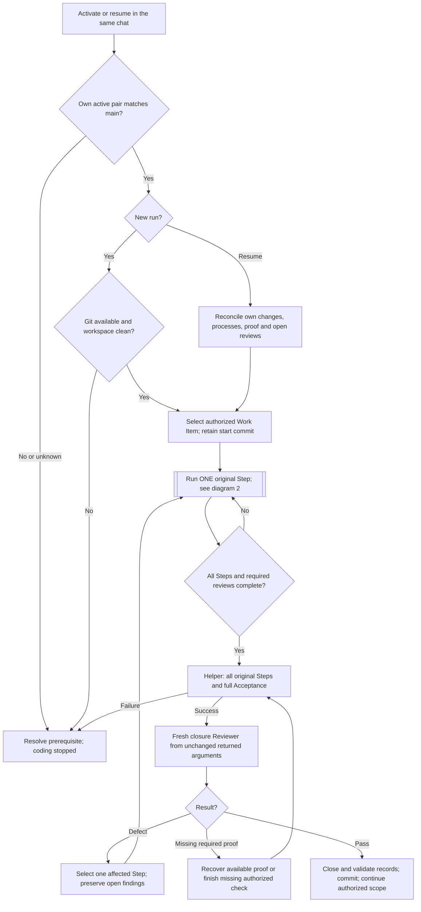
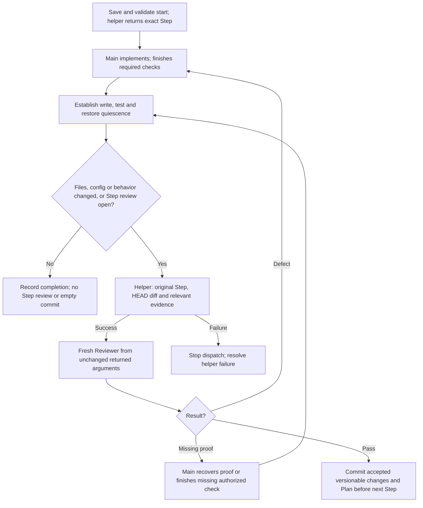
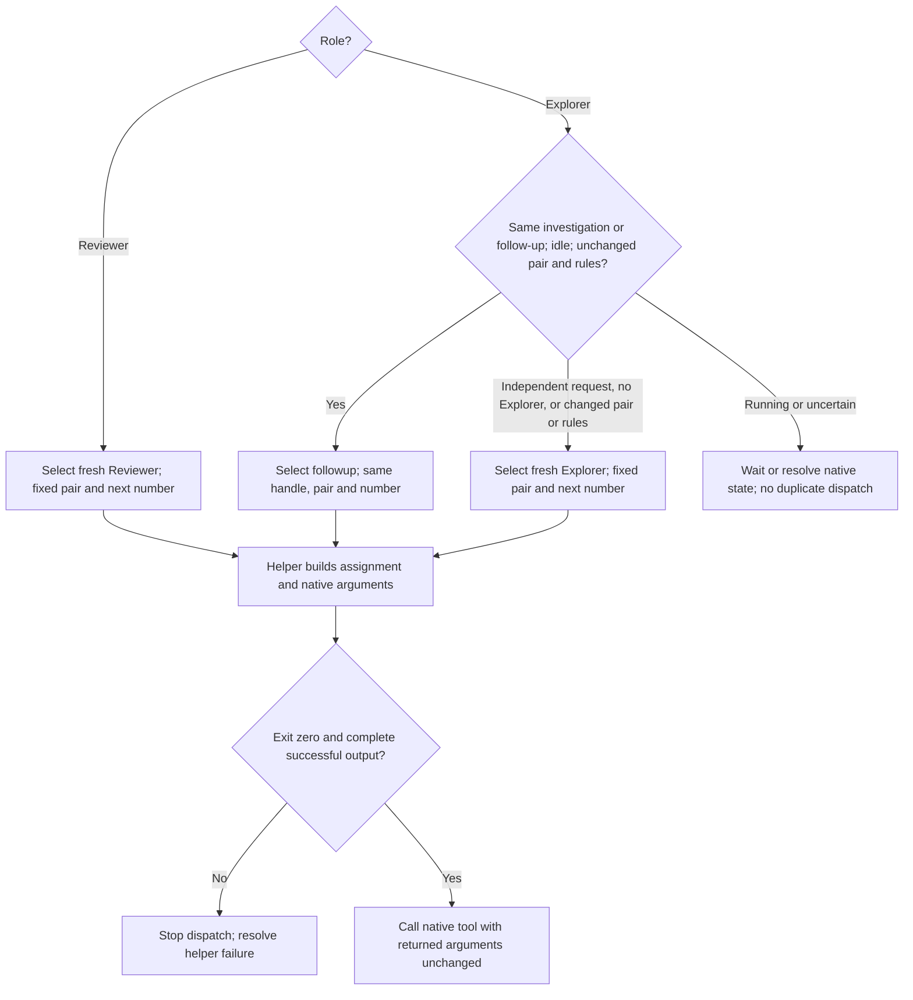
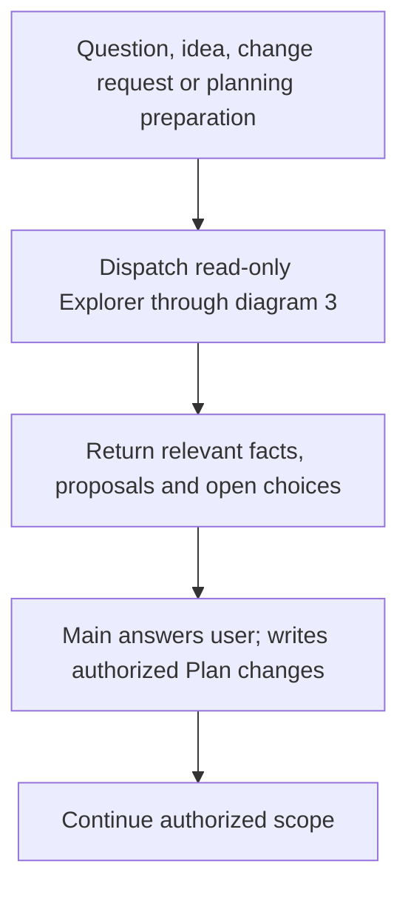

# Scoville Workflow for Codex

Mainloop takes a prepared Plan through implementation, independent review and
corrections. Your current chat plans, codes and runs checks. Read-only Explorer
and Reviewer subagents supply investigation and independent review.

Assign a complete Plan or a bounded part. For a tiny fix, coordination may cost
more than the fix. Workflow is available only through the complete Codex
Mainloop suite.

## How it works

The current chat owns the Plan, code, required checks and commits. It takes one
original Step at a time through the existing helper; it does not paraphrase the
assignment. Each review is fresh. Explorer reuse requires the same investigation,
an idle agent and unchanged pair/rules; an independent request starts fresh.
Agents choose relevant Skills without gaining additional role rights.

### 1. Main loop



The new-run Git gate never cleans or commits earlier work. Authorized resumption
reconciles the same started work without prematurely committing it. Missing or
foreign evidence remains an explicit boundary. Stops preserve unfinished work;
compaction continues this same chat from actual Plan, Git, effects and results.

### 2. Step implementation and review



Keep source and binding inputs unchanged during review. Closure uses the Work
Item start commit, not only the last Step diff. Unexpected HEAD movement must
be reconciled before an empty diff counts as unchanged. Git does not replace
proof of non-file effects. Preserve necessary nonrepeatable evidence through
existing results or artifacts; no mandatory per-Step report or source archive.

### 3. Child selection



Fresh children receive role, writing, shell and result rules once. Explorer
reuse sends its new task and needed context/evidence. Embedded writing and shell
rules satisfy their required reads; unchanged rules stay loaded. Machine-data,
Python discovery and large-output rules load when the operation needs them.
Fresh assignments include accepted Decision text or its valid binding-section
projection; reuse carries current source identities and reads new, changed or
uncertain Decisions. No context measurement or thresholds. Close finished Reviewers
only if native close exists. Interruption proves neither termination nor freed
capacity. Native types are optional; never raise thread limits automatically.

### 4. Questions and planning preparation



Known progress and stop/resume handling need no exploration. A scope-invalidating
change stops dependent implementation first. Explorer writes no Plan or code;
Reviewer runs no project tests. All roles follow the current user's language.

## What it enforces

- **Runtime:** Codex desktop, Python 3.11+, Git and the required native spawn,
  wait, inspection and interruption tools. Explorer reuse needs followup.
- **Start:** A new run requires a clean Git workspace. Authorized continuation
  reconciles its own started work; it never absorbs foreign changes.
- **Ownership:** Main plans, codes, checks and commits. Explorer and Reviewer
  remain read-only. Changed Steps receive independent review; every Work Item
  receives closure over all original Steps and full Acceptance.
- **Boundaries:** Commit accepted versionable Step changes and Plan before
  advancing. No intermediate, empty or foreign-change commit. Keep review quiet.
- **Children:** Every review is fresh, including corrections, evidence followups
  and closure. Explorer reuse retains rules and pair within the same investigation;
  independent requests get fresh Explorers, even in the same project or file.
- **Continuity:** Preserve actual effects, open reviews and stop position through
  compaction in the same chat. No automatic successor or capacity changes.

No minimum Codex version has been independently established. Optional native
type selection and close are not required. Use them only when exposed and
compatible. Agent capacity depends on the host's configured limit.

Workflow activation authorizes accepted-Step commits subject to user and project
restrictions. See [operations](https://github.com/benjaminstelzer/scoville-suite-for-codex-mainloop/blob/main/packages/scoville-workflow-for-codex/scoville-workflow-for-codex/references/operations.md).

## What it costs

Independent review and necessary corrections add tokens and time. Mainloop
removes the implementation child and its coordination. Every review initializes
a fresh agent; Explorer can retain context.

With identical fixture inputs, generated fresh Explorer text fell from 2,560 to
1,634 words and Step Reviewer text from 3,101 to 2,123 words. Explorer reuse stayed
at 268 words. These are generated-text measurements, separate from the recipient
tests below. They do not measure billed tokens, actual rule loads or execution time.

## How it was developed

Mainloop keeps planning, coding and checks in the main chat. Only read-only
Explorer and fresh Reviewer roles are delegated. It is the maintained Codex
edition, sharing the same source project and Plan as the General suite.

The current source consolidates role selection, Step and closure control, and
helper transport at their existing owners. Explicit upgrade instructions live
with Setup's migration operation. Recipient tests and generated-text measurements
cover different claims; the validation boundary below states what was observed.

### Review and continuation

In the current bounded tests, a Step Reviewer found a first-match implementation
that lost required duplicate entries, plus missing verification of that contract.
A separate closure Reviewer checked both original Steps and found an adapter
converting `None` to an empty string. Two fresh receivers of the complete Reviewer
finals selected the appropriate original Step for correction and kept findings,
evidence gaps and closure open. They performed no implementation or new checks.

### Validation boundary

On 2026-10-29, actual helper-generated fresh Explorer, same-handle Explorer
follow-up, Step Reviewer and closure Reviewer assignments were exercised in
Codex. Native turn records confirmed `gpt-6.1-sol / low`. The reused Explorer
retained ordering and nonmutation constraints without new tools or rule reads.

These bounded cases did not execute the correction-review-commit loop or establish
a successful Work Item closure, installed discovery or production acceptance.
The encrypted native message arguments prevented an independent full-text
transport comparison; strict transport byte identity is not claimed. Generated
prompt sizes are reported separately from observed recipient behavior.

## Compatibility

Requires the complete Codex Mainloop suite and the Python, Git and native tools
listed above, with evidence that the active main pair matches the configured pair.
The technical requirements do not establish behavior for every model or reasoning
setting. The validation boundary above describes the tested model and assignments;
installed discovery and independent backend model identity remain unverified.

## Install

Install and enable every Skill in the suite. Each applies to its own task scope.

Use the packages from
[Scoville Suite for Codex Mainloop](https://github.com/benjaminstelzer/scoville-suite-for-codex-mainloop/tree/main/packages).
Workflow only comes with the suite, and every Skill has to come from this
repository's own `packages/<name>/<name>/` directory. Don't swap in packages
from the individual repositories, and don't continue if members are missing.
Use the suite's new-installation prompt, or its explicit migration instructions
to move an earlier installation to the maintained Mainloop suite.


## Configuration

Schema 2 has three fixed model and reasoning pairs:

| Setting | Default model | Reasoning |
| --- | --- | --- |
| workflow.main | gpt-6.1-sol | high |
| workflow.review | gpt-6.1-sol | xhigh |
| workflow.explore | gpt-6.1-sol | high |

Use Setup to show or save project overrides in `.scoville/config.json`.
The main pair must match its own active native session before coding. Recheck
on activation, authorized resumption, a changed required pair, visible host-model
change or concrete loss of binding; not on every Step. Setup cannot change the
host model. Invisible host changes cannot be guaranteed detected.

Old route tables and context settings require explicit Setup cleanup. It asks
for main and any ambiguous role pair, preserves Ask and unrelated values, and
saves only a complete valid migration. Reads never migrate or create settings.
There are no per-Step model routes or context thresholds. Existing execute
annotations are retained and compared with main; conflicts require a decision.
See the [dispatch rules](https://github.com/benjaminstelzer/scoville-suite-for-codex-mainloop/blob/main/packages/scoville-workflow-for-codex/scoville-workflow-for-codex/references/operations-dispatch.md).

## Limitations

### Agent capacity

Codex retains native agent threads from earlier assignments, so longer
Workflow runs and Ask consultations can reach the host's agent limit.
To give these runs more room, raise the limit to 256 in
`~/.codex/config.toml` under `[agents]`. Add the section if it is missing:

```toml
[agents]
max_concurrent_threads_per_session = 256
```

This is the suite's recommendation for longer runs. The
[Codex configuration reference](https://learn.chatgpt.com/docs/config-file/config-reference)
describes the setting. If a start or necessary message still fails, the
affected operation stops and reports the problem with its progress preserved
for continuation.

## How to use

With the suite installed in Codex, activate Workflow in this saved project:

```text
Use $scoville-workflow-for-codex to execute the active Scoville Plan in this saved project.
```

Name a Work Item or stopping point to limit scope. Otherwise the main thread
executes the active Plan. Ask questions or stop during execution. Changed work
positions are brief; decisions go directly to you. Durable progress, unresolved
questions and evidence stay in the Plan. Stops and blockers are not completion.
Questions, change requests and planning preparation go to a read-only Explorer.
Explorer returns its findings; the main thread answers, writes the Plan and
implements within authorized scope.

"Start Scoville Workflow" also activates it. "Execute the Plan" alone does not.

All roles communicate in the language of your current message unless you request
another language. Required field names and technical literals stay unchanged;
Plans follow Plan's record-language rules.

## Sources

- [Agent Skills specification](https://agentskills.io/specification) for the
  portable package and progressive disclosure model.
- [OpenAI coding-agent best practices](https://developers.openai.com/codex/learn/best-practices)
  for explicit outcomes, constraints, planning, and completion evidence.

## Developer links

[Source](https://github.com/benjaminstelzer/scoville-suite-for-codex-mainloop/tree/main/members/scoville-workflow-for-codex) | [Tests](https://github.com/benjaminstelzer/scoville-suite-for-codex-mainloop/tree/main/members/scoville-workflow-for-codex/development/tests) | [Notes](https://github.com/benjaminstelzer/scoville-suite-for-codex-mainloop/blob/main/members/scoville-workflow-for-codex/development/README.md)

## License

MIT. See [LICENSE](LICENSE).
