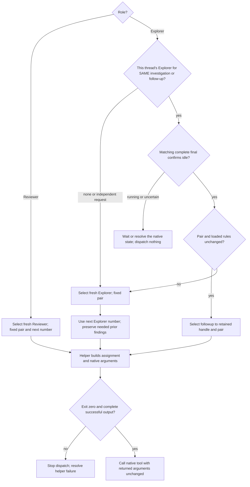

# Original tasks and native dispatch

| Option | Effect |
| --- | --- |
| `--unit W-001/step-2` | One original Step, for main or Step review. |
| `--unit W-001` | Reviewer closure. |
| `--plan PLAN-NNNN` | The canonical Plan; default is the active Plan. An Explorer may pass it, or omit both flags for a question without Plan context. |
| `--plan-root <directory>` | Reads Plan records from that project instead of `--project-root`; workspace and configured pairs stay unchanged. |
| `--selector <path>` | Replaces unit selection with a compatible Plan selector. Decision identity and binding projection still use the bundled Plan library and its format. Keep the custom selector's required sibling libraries with it. |
| `--max-output-bytes <bytes>` | Size budget for the selector's success payload. Too small a budget returns a diagnostic and a corrected call, never partial context. |

## Contents

- Fixed pairs
- Original main task
- Child selection
- Build and deliver child assignments

## Fixed pairs

```text
python "<workflow>/scripts/resolve_model_pair.py" --show-config --project-root "<workspace>"
python "<workflow>/scripts/resolve_model_pair.py" --role main --project-root "<workspace>"
```

The first command resolves schema-2 settings without writing. The
second compares this session's actual model and effort with the main pair. It
reads them from the session's own record: CODEX_THREAD_ID, session_meta,
task_started and turn_context. Configuration, self-report and user
confirmation alone are not that proof. Keep its session_path for later
required checks through `--session-path`. Missing or mismatching proof stops
coding. Operations names the check's triggers and what it cannot see; do not
run it per Step. The host pair is changed in Codex, not by Setup; Setup only stores the configured pair.

Use the fixed main, review and explore pairs; routes select no models. The
main-task helper compares an existing `[execute: ...]` annotation, even a
partial one, with main. On a match, continue. On a mismatch or unknown
fulfilment, obtain the user's choice before coding. Old Workflow settings need
an explicit Setup cleanup; reading never migrates them.

## Original main task

Save start/resume through Plan, then use the helper before the first edit:

```text
python "<workflow>/scripts/build_dispatch_prompt.py" --project-root "<absolute-workspace>" --plan PLAN-NNNN --unit W-001/step-2 --role main --communication-language "<language>"
```

The helper checks the saved active Plan, current item and in_progress Step,
then returns the original Step to main. It creates no child, reloads no rules
and reuses the verified main pair without another session query. Its output
lists Decision identities, not bodies. Before editing, read each linked
accepted Decision completely from its listed source, unless you still hold its
unchanged full text or valid original binding projection. After compaction,
restore that first and reread uncertain sources. Do not write a shortened
projection yourself; it could drop a condition.

## Child selection



After a confirmed child failure, follow operations before selecting a fresh
child. Dispatch measures no context and has no threshold or replacement
protocol. Use a native agent type only if the host exposes one compatible with
the fixed pair; do not emulate one or install custom agent files. Native
waits, complete finals and closing follow operations.

## Build and deliver child assignments

Write supplemental context under
[agent instruction design](instruction-design.md). Include the check results,
effects, attribution and limits the selected role needs. The helper adds the
role rules and result fields; add no role, result or writing instructions of your own.

```text
python "<workflow>/scripts/build_dispatch_prompt.py" --project-root "<absolute-workspace>" --plan PLAN-NNNN --unit W-001/step-2 --role reviewer --communication-language "<language>" --format create --project-name "<project>" --agent-number <number> --supplemental-context -
```

Send it through stdin with `--supplemental-context -` or as the path of an
existing UTF-8 file, never as literal text. Pass the relevant complete native
review final with `--reviewer-result`; when correcting one Step after closure,
that includes the closure finding. Only one input may use stdin. Pass finals
and Plan text unchanged; a summary or rewrite would give the Reviewer your
reading instead of the source.

The helper takes the rest from the Plan:

- Plan identity, Goal, Non-goals, Work Item fields, Instructions, the selected
  original Step and linked Decision sources.
- Fresh child: each accepted Decision in full, or its valid unchanged
  binding-section projection under Plan's Decision format. The main thread
  selects IDs, never sections or paraphrases.
- Step: without other Step bodies, accumulated Evidence and the Work Item's
  Next action.
- Closure: the full original Work Item and Acceptance.
- A fixed sentence that keeps Goal and Decisions from granting role rights.

| Child | Message |
| --- | --- |
| Fresh | Complete role, writing, shell and result rules, once; a Reviewer also the code-review policy. Embedded rules count as read. |
| Reused Explorer | New task, current binding context, complete needed inputs and communication language; Decision identities instead of retained bodies. It reads new, changed or uncertain Decisions completely; omitted nonbinding background is no reason to reread. Its unchanged rules and Skills stay loaded; it loads newly relevant sources and specialized references. |

Codex supplies project instructions; add no AGENTS.md loader.

For an Explorer, use `--role explorer --supplemental-context "<request.txt>"`
or stdin. Keep the user's exact request, the requested response format and the
investigation limits. For reuse, add `--agent-id`, the retained `--model` and
`--thinking` and the same agent number. If that pair conflicts with current
settings, create a fresh Explorer instead of silently changing followup's
model.

Pass the user's current or explicitly chosen language with
`--communication-language`; Plan language and locale do not select it.
Settings fix a fresh child's pair; manual flags cannot bypass them.
Number agents per role across Work Items and compaction; reuse keeps the
number.

An assignment up to 8 KiB UTF-8 goes directly into the native message. A
larger one uses a new system temporary file outside the project;
`--assignment-file` chooses a new absolute readable path instead. Keep the
file until the assignment ends. The child reads it completely before work, by
its chosen method. `--format prompt` returns text only.

Prepare complete UTF-8 files with literal-safe writes before dependent calls.
A missing input,
inaccessible assignment file, capacity refusal or helper failure stops that
operation:

- Correct the named cause before running it again.
- After a capacity refusal, spawn again only when a slot is actually free.
- Where the assignment file or spawn may already have taken effect, establish
  its actual state before another attempt.

Never dispatch twice, shorten or invent a result, or substitute a sidebar
chat. You may correct `--max-output-bytes` explicitly; a binding user or host
cap needs that party's decision.

Match complete native results to retained handles and assignments. Partial
messages and metadata are not results. Read a result delivered as a file
completely, under the shared output-delivery rules.
