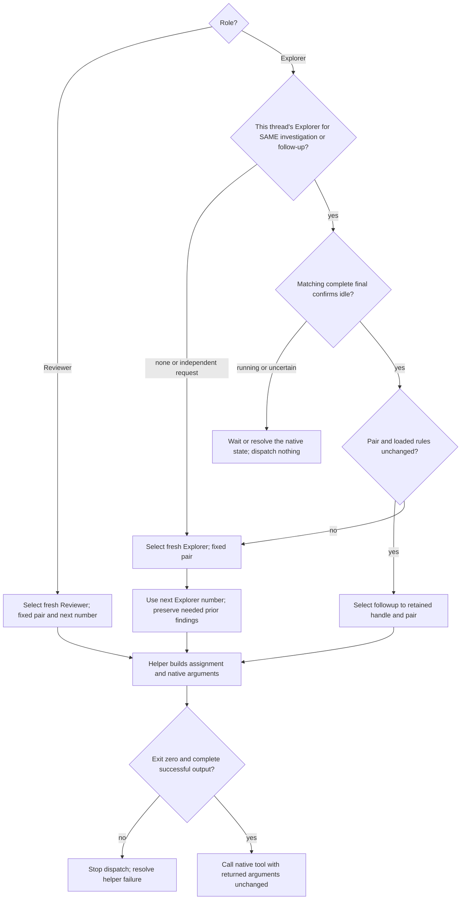

# Original tasks and native dispatch

`--unit W-001/step-2` selects one original Step for main or Step review.
`--unit W-001` selects Reviewer closure. `--plan PLAN-NNNN` selects the canonical
Plan (default: active). Explorer may include it or omit both flags for an
independent question.

## Fixed pairs

```text
python "<workflow>/scripts/resolve_model_pair.py" --show-config --project-root "<workspace>"
python "<workflow>/scripts/resolve_model_pair.py" --role main --project-root "<workspace>"
```

The first command resolves schema-2 settings without writing. The second checks
the own active native model and effort against main. It binds CODEX_THREAD_ID,
session_meta, task_started and turn_context; configuration, self-report and user
confirmation alone are not that proof. Retain its session_path for later required
checks through `--session-path`. A missing or mismatching proof stops coding.
The main-thread triggers and invisible-change limit are in operations; do not
query per Step. Change the host pair through Codex, never through Setup.

Use fixed main, review and explore pairs. Routes select no models.
The dispatcher compares existing execute annotations against main,
including partial annotations. A match needs no stop; a mismatch or unknown
fulfilment needs a user choice before coding, not a per-Step model change.
Old Workflow forms require explicit Setup cleanup; reading never migrates them.

## Original main task

Save start/resume through Plan, then use the helper before the first edit:

```text
python "<workflow>/scripts/build_dispatch_prompt.py" --project-root "<absolute-workspace>" --plan PLAN-NNNN --unit W-001/step-2 --role main --communication-language "<language>"
```

The helper returns the original Step to main and validates the saved active Plan,
current item and in_progress Step. It creates no child or rule reload and reuses
the verified main pair without another native query.
Main output lists Decision identities, not bodies. Before editing, read each linked
accepted source completely unless its unchanged full text or valid original binding
projection is already retained. After compaction, restore that binding first;
reread uncertain sources. Do not compose a shortened projection yourself.

## Child selection



Confirmed failure follows operations before fresh work. No context measurement,
threshold or replacement protocol is part of dispatch. Use native type selection
only if exposed and compatible with the fixed pair; do not emulate it or install
custom agent files. Operations owns native waits, complete finals and closing.

## Build and deliver child assignments

Before preparing an assignment or review input, apply the
[agent instruction design](instruction-design.md) rules at this producing step.
Keep original Plan text and complete native finals unchanged; include the checks,
effects, attribution and limits the selected role needs. The helper supplies the
role and result contracts; do not add the authoring workflow to its message.

```text
python "<workflow>/scripts/build_dispatch_prompt.py" --project-root "<absolute-workspace>" --plan PLAN-NNNN --unit W-001/step-2 --role reviewer --communication-language "<language>" --format create --project-name "<project>" --agent-number <number> --supplemental-context -
```

Send needed checks, effects, attribution and limits through stdin with
`--supplemental-context -`, or pass an existing UTF-8 file's path, not literal text.
`--reviewer-result` carries
the relevant complete native review final unchanged, including a closure finding
when correcting one Step. Only one input may use stdin. Never compose a replacement
final or rewrite Plan text as supplemental context.

The helper derives Plan identity, Goal, Non-goals, Work Item fields, Instructions,
selected original Step and linked Decision sources. Fresh children receive full
accepted Decisions or their valid unchanged binding-section projection under
Plan's Decision format. The main thread selects IDs, not sections or paraphrases.
Step assignments exclude other Step bodies, accumulated Evidence and Work Item
Next action. Closure includes the full original Work Item and Acceptance.
The helper's fixed scope sentence prevents Goal and Decisions granting role rights.

Fresh children receive complete role, writing, shell and result rules once;
Reviewers also receive the code-review policy. Embedded rules satisfy their
required reads. Codex supplies project instructions; add no AGENTS.md loader.
Explorer reuse sends the new task, current binding context, complete necessary
inputs and communication language, with Decision identities instead of retained
bodies. Read new, changed or uncertain Decisions completely; omitted nonbinding
background is no reread reason. Retained unchanged rules and Skills stay loaded;
load newly relevant sources and specialized references as needed.

For Explorer, use `--role explorer --supplemental-context "<request.txt>"` or stdin.
Preserve the user's exact request and requested response format with investigation
constraints.
For reuse, add `--agent-id`, its retained `--model` and `--thinking`
and the same agent number. If that pair conflicts with new settings, create a
fresh Explorer rather than silently changing followup's model.

Pass the user's current or explicitly chosen language with `--communication-language`;
Plan language and locale do not select it. Call the native direct tool with the
helper's arguments unchanged: fresh spawn or Explorer followup. Settings fix fresh
pairs; manual flags cannot bypass them. Number agents per role across items and
compaction; reuse keeps the number.

Assignments up to 8 KiB UTF-8 go directly into native messages. Larger assignments
use a new external system temporary file; `--assignment-file` can choose a new
absolute readable path. Keep it through the assignment. Children read it completely
before work using their chosen method. `--format prompt` returns text only.

Prepare complete UTF-8 files with literal-safe writes before dependent calls.
Require exit zero and complete successful output. Missing inputs, inaccessible
assignment files, capacity or helper failures stop that operation. Uncertain
publication or spawn effects require reconciliation before retry; no duplicates,
truncation, fabricated results or sidebar workaround. Internal selection budgets
can be corrected explicitly; binding user/host caps require their actual decision.

Match complete native results to retained handles and assignments. Partial messages
and metadata are not results. Read complete externalized results under shared
delivery rules. Read-only children may prepare only necessary oversized results;
they run no project tests, write no Plan records and create no other agents.
