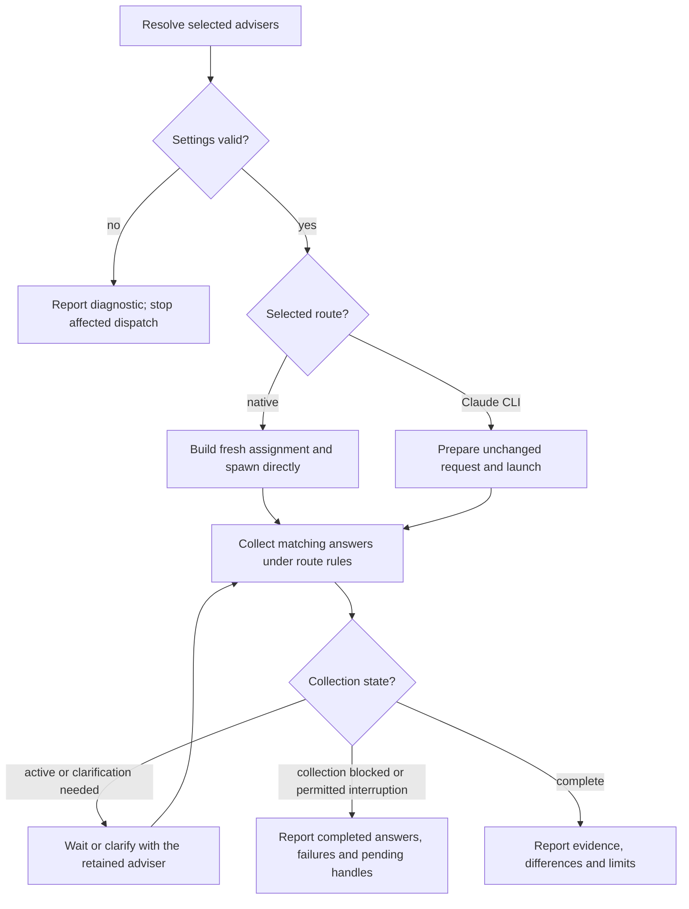

# Scoville Ask for Codex

Ask collects independent answers in the calling task. In a review, each
adviser assesses the same evidence. In a consultation, you synthesize the
independent answers. Advisers only inspect; they change nothing, run no tests
and do not delegate. Later changes are the caller's.

The helpers give advisers the shared writing rules and keep the user's literal
question unchanged. For an adviser question or follow-up you compose, apply
[agent instruction design](references/instruction-design.md).

## Choose the consultation

Infer `review` or `consultation` from the actual question; an explicit mode
wins. “Could this patch lose data?” is a review even without “for review”. If
you cannot tell which outcome the user wants, ask before dispatch. Do not ask about a mode, advisers or permission the request already establishes.

Resolve settings with `scripts/ask.py`:

| Priority | Settings source |
| --- | --- |
| 1 | Unsaved request overrides. |
| 2 | Selected project's `.scoville/config.json`, `ask` section. |
| 3 | [config.default.json](config.default.json). |

| Adviser selection | Presets |
| --- | --- |
| Explicitly named | Exactly those presets, even if absent from the default list. |
| None named | Default adviser list; it is not an allowlist. |

Use exactly the requested routes, models and efforts. Identify results by
adviser ID; a display name is not an agent handle. Resolve selected
presets in one call and report each adviser's settings. Read
[configuration and helper inputs](references/configuration.md) for settings
resolution, migration or the first helper call.

The actual host validates the requested model and effort when native
spawn_agent runs. Report a rejection; substitute no other model or route.

An explicit Ask request authorizes the full consultation: create the needed
adviser subagents, exchange the necessary questions and answers and return the
results, without separate approval for agents or messages and without
authorization fields. Respect explicit user limits and host requirements.
Native Ask uses direct collaboration tools in the calling chat.

## Ask and collect

Apply style rules only to the framing you write. Keep the user's literal
questions, quotations and technical data unchanged, except for authorized
edits and required secret redaction.

Prepare a self-contained question:

- Include scope, requirements and raw evidence, with paths and the
  working-tree scope when relevant.
- From a fresh consultation exclude your verdict and intermediate reasoning,
  previous adviser answers, unrelated history and secrets.

Read [native operation](references/native.md) or
[Claude operation](references/claude.md) for each selected route.

Dispatch each selected adviser independently, with fresh context and its
resolved settings, within host capacity and process limits. The route's
reference governs handle retention, collection and necessary follow-ups. Keep
partial answers and failures visible. Report a failed adviser instead of
replacing it: the user chose these advisers.

| Mode | Do |
| --- | --- |
| consultation | Synthesize agreement, differences and useful conclusions; invent no consensus. |
| review | Keep findings apart from untested concerns; verify findings before authorized fixes. |

Neither mode requires a second exchange round.

Apply [Evidence-based conclusions](references/writing.md#evidence-based-conclusions)
to exchanges with advisers. Present claims and evidence neutrally, also when
you ask whether an adviser accepts or objects, and do not press for agreement.
An unexplained concession does not resolve a finding. Consensus does not
replace a required review acceptance.

Retain requested and actually reported model and effort separately; unreported
values are unknown.

## Follow-up after completion

Retain the answer, evidence, settings and the exact native handle or Claude
session ID. Resume only for an explicitly requested follow-up, on the original
route with that exact ID; the most recent session may belong to another
consultation.

| Route | Follow-up settings |
| --- | --- |
| Native | Unchanged. A requested change needs a fresh adviser: explain that choice and obtain it unless already authorized. |
| Claude | Unchanged unless explicitly overridden. |

A completed review stays available: do not ask about keeping it open and do
not close it when the user changes topic. Claude print mode exits after its
answer; a retained ID is saved history, not a running agent.

All Skills in this suite are installed and enabled together. Use the
Skill that owns a concern without checking its availability, and load only the
instructions the task needs.
Do not use a Skill that needs explicit activation before it is activated, or
one the user excluded.

A native adviser creates temporary files only to deliver an oversized answer,
under [native delivery](references/native-delivery.md). Native spawning adds
no technical write barrier or separate sandbox. The Claude route has its own
tool restrictions and opt-in web access.

## Shared references

Read one when its condition holds. A complete copy already in context counts
as read, including one embedded in your assignment. Read it again only when
that copy is incomplete or a reload is requested.

- [Writing](references/writing.md): a plan, decision, instruction, review, handoff or a report the user asked for as the result; a disputed conclusion.
- [Machine data](references/machine-data.md): a structured report, log file or saved state you must evaluate, such as JUnit XML or coverage data; a test runner's console summary is not one.
- [Shell commands](references/shell-commands.md): composed text or scripts passed through a shell; quoting, PowerShell encoding, exact bytes or several exit statuses matter.
- [Output delivery](references/output-delivery.md): before a command whose output may exceed the display limit; text that must fit a known limit; delivery as a file.
- [Python discovery](references/python-discovery.md): a Python command or bundled helper, no interpreter verified this session.
- [Instruction design](references/instruction-design.md): a reusable instruction, Skill rule or prompt template.
