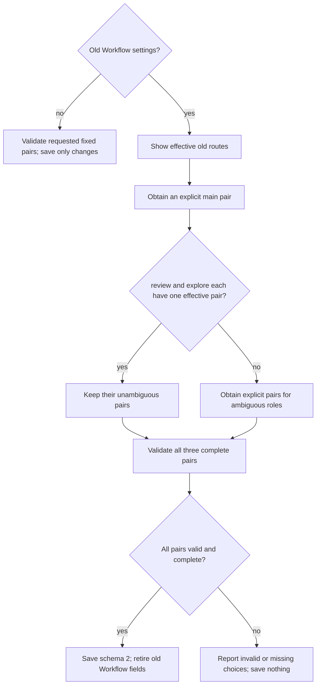

# Scoville Setup

All Skills in this suite must be installed and enabled. Use the applicable
owner without rechecking sibling availability; load only task-needed instructions.
Explicit activation requirements and user exclusions remain applicable.

Manage `.scoville/config.json` in the known absolute project root. Overrides
apply per field. There is no personal layer or parent-directory search.
Before requesting or reading machine reports, logs or structured state, evaluating
settings, explaining results or answering a disputed factual or technical conclusion,
read the [shared writing rules](references/writing.md). Reuse retained matching rules.

## Operations

```text
python "<setup-skill-directory>/scripts/setup.py" show --project-root "<project-root>"
python "<setup-skill-directory>/scripts/setup.py" set --project-root "<project-root>"
python "<setup-skill-directory>/scripts/setup.py" cleanup --project-root "<project-root>"
```

| Operation | Contract |
| --- | --- |
| show | Read only. Show effective fixed pairs or resolve old routes with cleanup_required. Report invalid sections together under ok:false, without partial effective success. Create no file. |
| set | Save only explicitly requested fields. An old Workflow form requires cleanup before a Workflow save; Ask-only saves leave it unchanged. |
| cleanup | Migrate old Workflow settings to schema 2 only when explicitly authorized. Ask and foreign values remain unchanged. An unchanged valid configuration returns saved: false. |
| One-time Ask override | Load Scoville Ask for Codex and read its `references/configuration.md` for read-only settings resolution. Report resolved values without saving or starting advisers. |

Generate stdin JSON with a serializer. Follow the loaded
[shell command rules](references/shell-commands.md) for UTF-8 stdin.
Use `ask`, `workflow` or both for set; use only `workflow` for cleanup.
Include only requested changes. Set offers low, medium, high and xhigh; keep
existing special levels on unrelated saves and migration. Do not hand-write transport JSON
or silently substitute values. The helper validates changed sections before saving. An invalid choice
does not authorize a partial save.

For supported special reasoning levels, the user can edit `.scoville/config.json`
manually. Agent-driven configuration changes use the helpers above.

Check the returned file, saved flag and requested effective values before
reporting success. Report a mismatch or error with its concrete diagnostic;
do not automatically repeat or broaden the save. `saved: false` says this operation wrote nothing; it
does not mean overrides are absent. Set returns only changed effective sections.

## Workflow pairs and migration

Schema 2 has fixed `main`, `review` and `explore` pairs, each with `model` and
`reasoning`. For set, patch only requested fields, such as
`workflow.review.reasoning`. Cleanup choices supply complete pairs.
Defaults come from [Workflow](assets/workflow.toml); do not copy their values
into these instructions. The host controls the actual main-thread model.
Saving its required pair does not change or verify the host model.



Never derive main from execute. Explorer candidates use fieldwise inheritance
from the effective old execute routes. Different pairs have no automatic
winner. Preserve supported special reasoning levels; actual model support still
determines execution. Cleanup starts no agents or tests, edits no Plan and
changes no `.codex` settings. Migrate between runs or at the authorized safe
boundary below.

For an explicitly authorized upgrade of a running project, first let the old
version reach a reviewed, quiescent commit boundary, preferably Work Item
closure. Preserve needed old closure evidence before reload. If essential
proof is only volatile, save it once in a unique ignored
`.scoville/temp/workflow-migration-<Plan>-<WorkItem>-<Nr>.txt` and reference it
in existing Evidence; commit a changed tracked Plan before reload. This adds
no archive or per-Step report. If essential proof cannot be preserved, do not
switch within the Work Item.

Then reload and explicitly run Setup cleanup with the chosen pairs. Separately
commit a tracked configuration change under project checks before authorized
continuation; untracked configuration needs no commit. These instructions grant
no upgrade, cleanup, commit or continuation permission. Installation proves
neither cleanup, host-model change nor reload.

## Ask

Ask [defaults](assets/ask.default.json) own adviser values. Saved sections are
`advisers`, `presets` and `claude`. Adviser selection replaces the previous list.
Claude fields are `max_budget_usd`, `session_persistence`, `customizations`,
`timeout_seconds` and `web_tools`. A finite budget of zero removes the helper
cap, not charges, provider limits or timeouts. Preserve existing `ask.pin_threads`
on unrelated saves; it has no effect on native advisers.

Keep a one-time choice in the request or Plan Step unless the user explicitly
asks to save it. Change saved settings between runs. Setup never starts advisers
or Workflow, installs or updates Skills, publishes packages, creates a monitor
or adds another configuration system.

Before invoking this Skill's task helpers, apply the policy below and
read [shell command rules](references/shell-commands.md).

## Runtime helpers

Use the bundled helpers for their operations. Read their invocation instructions,
not their source, unless diagnosing a failure.

| Condition | Required route |
| --- | --- |
| Python and every named helper are available | Use the bundled helper. |
| Missing Python, script, dependency or helper error | Stop the affected operation; do not substitute manual execution. |

Helpers: `scripts/setup.py`.
