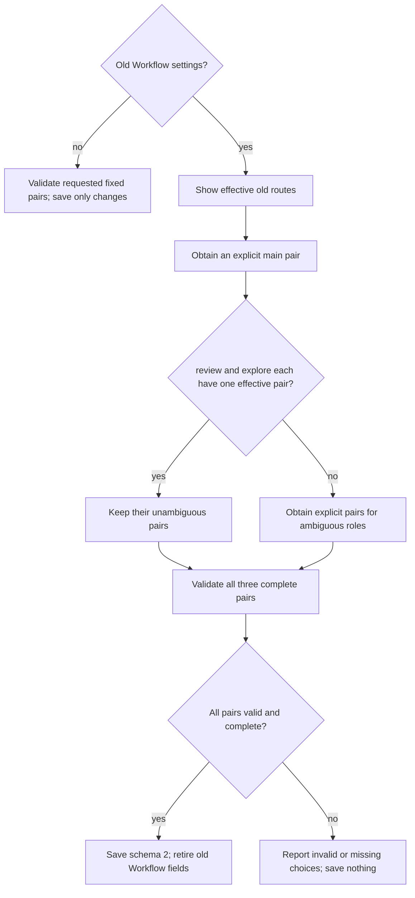

# Scoville Setup

All Skills in this suite are installed and enabled together. Use the
applicable owner without checking sibling availability, and load only the
instructions the task needs.
A Skill that needs explicit activation stays out until it is activated, and
one the user excluded stays out.

Manage `.scoville/config.json` in the known absolute project root. Overrides
apply per field. There is no personal layer or parent-directory search.

## Operations

```text
python "<setup-skill-directory>/scripts/setup.py" show --project-root "<project-root>"
python "<setup-skill-directory>/scripts/setup.py" set --project-root "<project-root>"
python "<setup-skill-directory>/scripts/setup.py" cleanup --project-root "<project-root>"
```

| Operation | Contract |
| --- | --- |
| show | Read only. Show effective fixed pairs or resolve old routes with cleanup_required. Report invalid sections together under ok:false, without partial effective success. Create no file. |
| set | Save only explicitly requested fields. An old Workflow form requires cleanup before a Workflow save; Ask-only saves leave it unchanged. |
| cleanup | Migrate old Workflow settings to schema 2 only when explicitly authorized. Ask and foreign values remain unchanged. An unchanged valid configuration returns saved: false. |
| One-time Ask override | Load Scoville Ask for Codex and read its `references/configuration.md` for read-only settings resolution. Report resolved values without saving or starting advisers. |

Generate the UTF-8 stdin JSON with a serializer rather than by hand, since a quoting
slip changes the saved value. Use `ask`, `workflow` or both for set and
only `workflow` for cleanup, and include only the requested changes with the
values the user gave. Set offers low, medium, high and xhigh; existing special
levels survive unrelated saves and migration. The helper validates changed
sections before saving. An invalid choice does not authorize a partial save.

For supported special reasoning levels, the user can edit `.scoville/config.json`
manually. Agent-driven configuration changes use the helpers above.

Check the returned file, saved flag and requested effective values before
reporting success. Report a mismatch or error with its concrete diagnostic; a
repeated save, or one with fewer, other or wider values, needs the user.
`saved: false` says this operation wrote nothing, not that overrides are
absent. Set returns only changed effective sections.

## Workflow pairs and migration

Schema 2 has fixed `main`, `review` and `explore` pairs, each with `model` and
`reasoning`. For set, patch only requested fields, such as
`workflow.review.reasoning`. Cleanup choices supply complete pairs.
Defaults come from [Workflow](assets/workflow.toml), the one place that lists
their values. The host controls the actual main-thread model; saving its
required pair neither changes nor verifies it.



The main pair always comes from the user, never from the old execute routes,
because the host's main model was never part of them. Explorer candidates use
fieldwise inheritance from the effective old execute routes, and different
pairs have no automatic winner. Preserve supported special reasoning levels;
actual model support still determines execution. Cleanup only rewrites
`.scoville/config.json`: it starts no agents or tests and leaves Plans and
`.codex` settings alone. Migrate between runs or at the authorized safe
boundary below.

For an explicitly authorized upgrade of a running project, first let the old
version reach a reviewed, quiescent commit boundary, preferably Work Item
closure. Preserve needed old closure evidence before reload. If essential
proof is only volatile, save it once in a unique ignored
`.scoville/temp/workflow-migration-<Plan>-<WorkItem>-<Nr>.txt` and reference it
in existing Evidence; commit a changed tracked Plan before reload. One such
file is enough; no archive or per-Step report is needed. If essential proof
cannot be preserved, finish the Work Item on the old version before switching.

Then reload and explicitly run Setup cleanup with the chosen pairs. Separately
commit a tracked configuration change under project checks before authorized
continuation; untracked configuration needs no commit. The upgrade, the
cleanup, the migration commits and the continuation need the user's
authorization; these steps do not supply it. An installed new version proves
neither cleanup, host-model change nor reload.

## Ask

Ask [defaults](assets/ask.default.json) own adviser values. Saved sections are
`advisers`, `presets` and `claude`. Adviser selection replaces the previous list.
Claude fields are `max_budget_usd`, `session_persistence`, `customizations`,
`timeout_seconds` and `web_tools`. A finite budget of zero removes the helper
cap, not charges, provider limits or timeouts. Preserve existing `ask.pin_threads`
on unrelated saves; it has no effect on native advisers.

Keep a one-time choice in the request or Plan Step unless the user explicitly
asks to save it. Change saved settings between runs. Setup only reads and
writes this configuration; starting advisers or Workflow, installing or
updating Skills and publishing packages belong to their own requests. Setup
creates no monitor and no second configuration system.

## Runtime helpers

Use the bundled helpers for their operations. Read their invocation instructions,
not their source, unless diagnosing a failure.

| Condition | Required route |
| --- | --- |
| Python and every named helper are available | Use the bundled helper. |
| Missing Python, script, dependency or helper error | Stop the affected operation; do not substitute manual execution. |

Helpers: `scripts/setup.py`.

## Shared references

Read one when its condition holds. A complete copy already in context from
this build, including one embedded in your assignment, counts as read; read it
again when it is incomplete or uncertain or a reload is requested.

- [Writing](references/writing.md): a plan, decision, instruction, review, handoff or report; a disputed conclusion.
- [Machine data](references/machine-data.md): a test report, log or structured state as a result.
- [Shell commands](references/shell-commands.md): composed text or scripts passed through a shell; quoting, PowerShell encoding, exact bytes or several exit statuses matter.
- [Output delivery](references/output-delivery.md): before a command whose output may exceed the display limit or whose effect or result cannot be repeated; text that must fit a known limit; delivery as a file.
- [Python discovery](references/python-discovery.md): a Python command or bundled helper, no interpreter verified this session.
- [Instruction design](references/instruction-design.md): a reusable instruction, Skill rule or prompt template.
