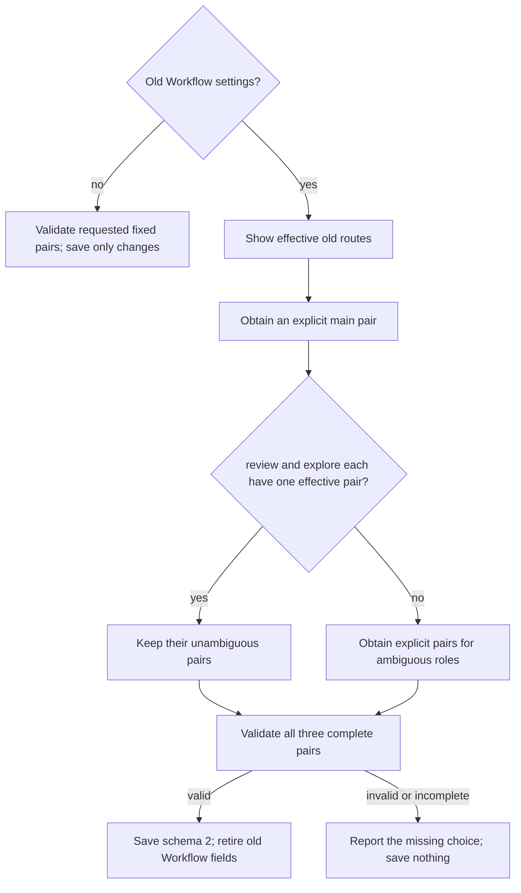

# Scoville Setup

All Skills included in this suite must be installed and enabled. Use the
applicable owner without checking sibling availability. Load only instructions
needed for the task. Explicit invocation gates and user exclusions still apply.

Manage `.scoville/config.json` in the known absolute project root. Overrides
apply per field. There is no personal layer or parent-directory search.
Read the [shared writing rules](references/writing.md) before evaluating settings
or explaining results. Reuse retained matching rules.

Reuse an already verified interpreter meeting this Skill's Python 3.11+
requirement. Otherwise check `py -3`
on Windows or `python3` elsewhere; try `python` if needed. Choose it locally,
without asking the user. Verify its version before the first helper operation.
Use that executable wherever examples say `python` or `<verified-python>`,
including Python commands after `--run --`.
Report a missing runtime only when no suitable installed interpreter is found.

Before processing machine reports or logs, use the [shared writing rules](references/writing.md).
If their complete text is not loaded, read it in a separate call before reading
the data. Reuse retained rules under their existing reload conditions.
Before helper calls, follow [shell command rules](references/shell-commands.md).

## Operations

```text
python "<setup-skill-directory>/scripts/setup.py" show --project-root "<project-root>"
python "<setup-skill-directory>/scripts/setup.py" set --project-root "<project-root>"
python "<setup-skill-directory>/scripts/setup.py" cleanup --project-root "<project-root>"
```

| Operation | Contract |
| --- | --- |
| show | Read only. Show effective fixed pairs or resolve old routes with cleanup_required. Create no file. |
| set | Save only explicitly requested fields. An old Workflow form requires cleanup before a Workflow save; Ask-only saves leave it unchanged. |
| cleanup | Explicitly migrate old Workflow settings to schema 2. Ask and foreign values remain unchanged. An unchanged valid configuration returns saved: false. |

Generate stdin JSON with a serializer such as Python `json.dumps` or PowerShell
`ConvertTo-Json -Depth 10 -Compress`. In PowerShell, set
`$OutputEncoding = [System.Text.UTF8Encoding]::new($false)` before piping UTF-8.
Use `ask`, `workflow` or both for set; use only `workflow` for cleanup.
Include only requested changes. Do not hand-write JSON or silently substitute
values. The helper validates changed sections before saving. An invalid choice
does not authorize a partial save.

Check the returned file, saved flag and requested effective values before
reporting success. A mismatch or error needs its concrete diagnostic, not an
automatic broader save. `saved: false` says this operation wrote nothing; it
does not mean overrides are absent. Set returns only changed effective sections.

## Workflow pairs and migration

Schema 2 has `main`, `review` and `explore`, each with `model` and `reasoning`.
Defaults come from [Workflow](assets/workflow.toml); do not copy their values
into these instructions. The host controls the actual main-thread model.
Saving its required pair does not change or verify the host model.



Never derive main from execute. Explorer candidates use fieldwise inheritance
from the effective old execute routes. Different pairs have no automatic
winner. Preserve supported special reasoning levels; actual model support still
determines execution. Cleanup starts no agents or tests, edits no Plan and
changes no `.codex` settings. Migrate between runs or at the authorized safe
boundary specified by Workflow.

## Ask

Ask [defaults](assets/ask.default.json) own adviser values. Saved sections are
`advisers`, `presets` and `claude`. Adviser selection replaces the previous list.
Claude fields are `max_budget_usd`, `session_persistence`, `customizations`,
`timeout_seconds` and `web_tools`. A finite budget of zero removes the helper
cap, not charges, provider limits or timeouts. Preserve existing `ask.pin_threads`
on unrelated saves; it has no effect on native advisers.

For a one-time Ask override, use Ask for Codex's read-only settings resolution
under `references/configuration.md`. Show the resolved values without starting
advisers or saving unrequested settings. Setup never starts Workflow, installs
Skills, publishes packages or creates a monitor.

## Runtime helpers

Use the bundled helpers for their operations. Read their invocation instructions,
not their source, unless diagnosing a failure.

| Condition | Required route |
| --- | --- |
| Python and every named helper are available | Use the bundled helper. |
| Missing Python, script, dependency or helper error | Stop the affected operation; do not substitute manual execution. |

Helpers: `scripts/setup.py`, `scripts/check_text_size.py`.
