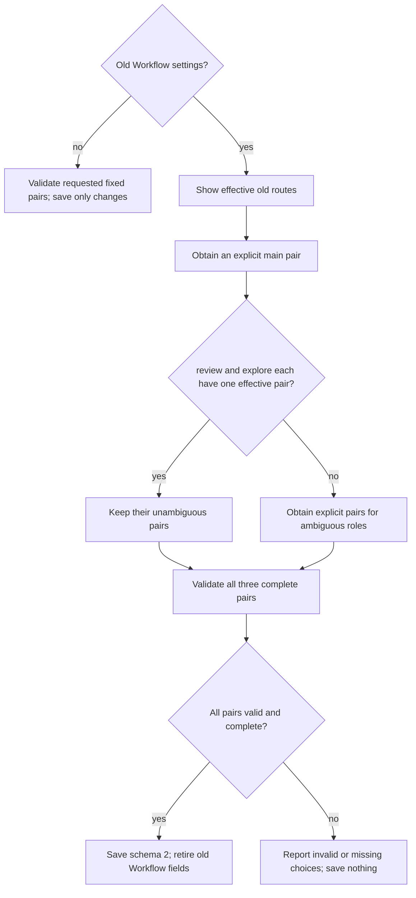

# Scoville Setup

All Skills in this suite are installed and enabled together. Use the
Skill that owns a concern without checking its availability, and load only the
instructions the task needs.
Do not use a Skill that needs explicit activation before it is activated, or
one the user excluded.

Manage `.scoville/config.json` in the selected project's absolute root. Saved
values override defaults per field. There is no personal layer and no
parent-directory search.

## Operations

```text
python "<setup-skill-directory>/scripts/setup.py" show --project-root "<project-root>"
python "<setup-skill-directory>/scripts/setup.py" set --project-root "<project-root>"
python "<setup-skill-directory>/scripts/setup.py" cleanup --project-root "<project-root>"
```

| Operation | Behavior |
| --- | --- |
| show | Reads only; creates no file. Shows effective fixed pairs, or resolves old routes with cleanup_required. Reports invalid sections together under ok:false, without partial effective success. |
| set | Saves only explicitly requested fields. Old Workflow settings need cleanup before a Workflow save; an Ask-only save leaves them unchanged. |
| cleanup | Migrates old Workflow settings to schema 2, only when explicitly authorized. Ask and foreign values stay unchanged. An unchanged valid configuration returns saved: false. |
| One-time Ask override | Load Scoville Ask for Codex and resolve settings read-only as its `references/configuration.md` describes. Report the resolved values; save nothing and start no adviser. |

Set and cleanup read UTF-8 JSON from stdin:

- Generate it with a serializer, not by hand; a quoting slip changes the saved
  value.
- Use `ask`, `workflow` or both for set, and only `workflow` for cleanup.
- Include only the requested changes, with the values the user gave.
- Set offers low, medium, high and xhigh. Existing special levels survive
  unrelated saves and migration.

The helper validates changed sections before saving. An invalid value does not
authorize a partial save. The user can edit `.scoville/config.json` manually
for supported special reasoning levels; agent-driven changes use the helpers
above.

Before reporting success, check the returned file, the saved flag and that
each requested value is effective. Report a mismatch or error with its
concrete diagnostic. Saving again, or saving fewer, other or wider values,
needs the user. `saved: false` means this operation wrote nothing; overrides
may still exist. Set returns only changed effective sections.

## Workflow pairs and migration

Schema 2 has fixed `main`, `review` and `explore` pairs, each with `model` and
`reasoning`. With set, send only requested fields, such as
`workflow.review.reasoning`. With cleanup, send complete pairs. Defaults come
from [Workflow](assets/workflow.toml), the one place that lists their values.
The host controls the actual main-thread model; saving the `main` pair neither
changes nor verifies it.



Obtain the main pair from the user, never from the old execute routes: the
host's main model was never part of them. Explorer candidates inherit field
by field from the effective old execute routes; different pairs have no
automatic winner. Preserve supported special reasoning levels; actual model
support still determines execution. Cleanup only rewrites
`.scoville/config.json`: it starts no agents or tests and leaves Plans and
`.codex` settings alone. Migrate between runs or at the safe boundary below.

To upgrade a running project, the user must explicitly authorize the upgrade,
the cleanup, the migration commits and the continuation; these steps grant none:

1. Let the old version reach a reviewed, quiescent commit boundary, preferably
   Work Item closure.
2. Preserve the old closure evidence still needed. If essential proof is only
   volatile, save it once in a unique ignored
   `.scoville/temp/workflow-migration-<Plan>-<WorkItem>-<Nr>.txt` and
   reference it in existing Evidence. One file is enough; no archive or per-Step report is needed. If essential proof cannot be preserved, finish the Work Item on the old version before switching.
3. Commit a changed tracked Plan.
4. Reload, then explicitly run Setup cleanup with the chosen pairs.
5. Before the authorized continuation, commit a tracked configuration change
   separately under project checks. Untracked configuration needs no commit.

An installed new version proves neither cleanup, host-model change nor reload.

## Ask

Ask [defaults](assets/ask.default.json) hold the adviser values. Saved sections
are `advisers`, `presets` and `claude`. A saved `advisers` list replaces the
previous one. Claude fields are `max_budget_usd`, `session_persistence`,
`customizations`, `timeout_seconds` and `web_tools`. A finite budget of zero
removes the helper cap; charges, provider limits and timeouts remain. Preserve
an existing `ask.pin_threads` on unrelated saves; it has no effect on native
advisers.

Keep a one-time choice in the request or Plan Step; save it only when the user
explicitly asks. Change saved settings between runs. Setup only reads and
writes this configuration. Starting advisers or Workflow, installing or
updating Skills and publishing packages each need their own request. Setup
creates no monitor and no second configuration system.

## Runtime helpers

Use the bundled helpers for their operations. Read their invocation instructions,
not their source, unless diagnosing a failure.

| Condition | Required route |
| --- | --- |
| Python and every named helper are available | Use the bundled helper. |
| Missing Python, script, dependency or helper error | Stop the affected operation; do not substitute manual execution. |

Helpers: `scripts/setup.py`.

## Shared references

Read one when its condition holds. A complete copy from this build already in
context counts as read, including one embedded in your assignment. Read it again when it is incomplete, when you are not certain it is the complete copy from this build, or when a reload is requested.

- [Writing](references/writing.md): a plan, decision, instruction, review, handoff or report; a disputed conclusion.
- [Machine data](references/machine-data.md): a test report, log or structured state as a result.
- [Shell commands](references/shell-commands.md): composed text or scripts passed through a shell; quoting, PowerShell encoding, exact bytes or several exit statuses matter.
- [Output delivery](references/output-delivery.md): before a command whose output may exceed the display limit or whose effect or result cannot be repeated; text that must fit a known limit; delivery as a file.
- [Python discovery](references/python-discovery.md): a Python command or bundled helper, no interpreter verified this session.
- [Instruction design](references/instruction-design.md): a reusable instruction, Skill rule or prompt template.
