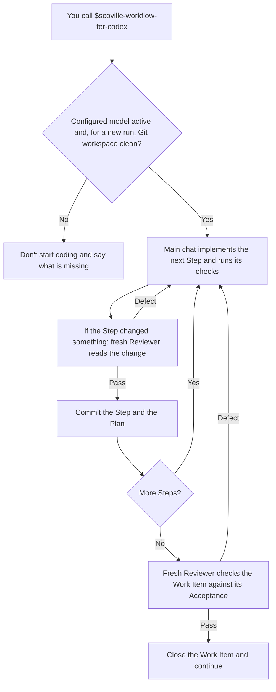

# Scoville Workflow for Codex

Mainloop takes a prepared Plan through implementation, independent review and
corrections. Your current chat plans, codes and runs checks. Read-only Explorer
and Reviewer subagents supply investigation and independent review.

Scoville measures chili heat. Workflow keeps one cook at the stove and has
someone else taste before anything is served. Earlier versions had more cooks.
The chili did not improve.

Assign a complete Plan or a bounded part. For a tiny fix, coordination may cost
more than the fix. Workflow is available only through the complete Codex
Mainloop suite.

## How it works



- The chat you're in does the work. It plans, codes, runs the checks and
  commits, one Step at a time, exactly as the Plan states it.
- Every Step that changed something gets a fresh, read-only Reviewer. When all
  Steps are done, another fresh Reviewer checks the whole Work Item against
  its Acceptance, unless the Work Item has a single Step, whose review then
  covers the Acceptance.
- Questions, ideas and change requests that need investigation go to a
  read-only Explorer. The main chat answers you and updates the Plan. Neither Explorer
  nor Reviewer writes code or Plan records or runs tests.
- Calling Workflow allows it to commit accepted Steps and their Plan records,
  unless you or the project rules say otherwise. A new run needs a clean Git
  workspace. Workflow won't clean up or commit earlier work to get one.
- When Codex compacts the chat, Workflow carries on in the same chat from the
  Plan, Git and the actual results.

## What it costs

Reviews and the corrections they find add tokens and time. Every review starts
a fresh agent. An Explorer can keep its context for follow-up questions.

## How to use

In a saved Codex project:

```text
Use $scoville-workflow-for-codex to execute the active Scoville Plan in this saved project.
```

That call is the only way to start or resume a run - "execute the Plan" on its
own won't do it. Name a Work Item or a stopping point to limit the scope. You
can ask questions or stop at any time. Progress and open questions stay in the
Plan, and a stop isn't completion. Workflow answers in the language of your
latest message unless you ask for another one.

## Install

Workflow needs Codex desktop with native agents, Python 3.11+ and Git. It only
comes with [Scoville Suite for Codex Mainloop](https://github.com/benjaminstelzer/scoville-suite-for-codex-mainloop),
and every Skill has to come from
[that suite's packages](https://github.com/benjaminstelzer/scoville-suite-for-codex-mainloop/tree/main/packages).
The suite README has the install request and the steps for moving from an
earlier Codex suite.

## Configuration

| Setting | Default model | Reasoning |
| --- | --- | --- |
| `workflow.main` | gpt-6.2-sol | high |
| `workflow.review` | gpt-6.2-sol | xhigh |
| `workflow.explore` | gpt-6.2-sol | high |

Change them with Scoville Setup between runs. It saves them in
`.scoville/config.json`. Before coding, Workflow checks that your chat
actually runs the main model and reasoning level. Setup can't switch that for
you - you change the chat's model in Codex.

## Limitations

Codex keeps the agent threads of earlier assignments, so longer Workflow runs
and Ask consultations can hit its agent limit. I recommend raising it to 256
in `~/.codex/config.toml`. Add the section if it's missing:

```toml
[agents]
max_concurrent_threads_per_session = 256
```

The [Codex configuration reference](https://learn.chatgpt.com/docs/config-file/config-reference)
describes the setting. If a start still fails, the affected operation stops,
reports it and keeps its progress for the next run.

## Background

[Operations](https://github.com/benjaminstelzer/scoville-suite-for-codex-mainloop/blob/main/packages/scoville-workflow-for-codex/scoville-workflow-for-codex/references/operations.md) has the full procedure. Sources: the
[Agent Skills specification](https://agentskills.io/specification) and
[OpenAI's coding-agent best practices](https://developers.openai.com/codex/learn/best-practices).

## License

MIT. See [LICENSE](LICENSE).
